# ChimpHood Implementation Plan v2

**Document Version**: 2.4.3
**Date**: November 1, 2026
**Status**: DEC-022 RECORDED — GTD REVOCATION FULL DISQUALIFICATION ENFORCED
**Author**: Engineering Team & System Architect
**Supersedes**: Stage 1–6 Planning in `docs/handoff.md` & Implementation Plan v2.0.0 / v2.1.0 / v2.2.0 / v2.3.0 / v2.3.1 / v2.3.2 / v2.3.3 / v2.3.4 / v2.3.5 / v2.3.6 / v2.3.7 / v2.3.8 / v2.3.9 / v2.4.0 / v2.4.1 / v2.4.2
**Target Workspace**: `/Users/hermawanprastiyanto/Desktop/ChimpHood Site`

---

## 1. Project Overview

ChimpHood is a decentralized community engagement and NFT distribution platform built on Next.js 16 (React 19), PostgreSQL (via Prisma ORM v7 deployed on Supabase Seoul), and Wagmi v3.

The platform implements an off-chain gamified allowlist qualification system:
1. **Trait Drops & Inventory**: Users collect trait items across five distinct categories (`BG`, `FUR`, `CLOTHING`, `HEADWEAR`, `EYEWEAR`) via periodic drop periods and peer-to-peer trait gifting.
2. **Promotional Tasks & Campaigns**: Users complete verifiable social and on-platform tasks (such as linking an X/Twitter account and submitting proof evidence reviewed by moderators).
3. **Whitelist Allocation (GTD & FCFS)**:
   - **GTD (Guaranteed)**: Admin sets the GTD quota (e.g. 1,000 slots). Users who satisfy all 5 WL eligibility criteria receive a GTD slot immediately as long as quota remains available (`allocatedSlotsCount < totalSlots`). This instant allocation upon qualification is governed strictly by DEC-014.
   - **Shared Pessimistic Capacity Guard**: Both instant allocation (`server/whitelist/qualification.ts`) and manual GTD grant (`server/admin/manual-grant.ts`) execute the exact same concurrency guard: a **pessimistic row-level lock on `WLProgram` (`SELECT ... FOR UPDATE`)** inside their interactive transaction. After acquiring the lock, both paths re-read `allocatedSlotsCount` and `totalSlots`. This serializes all allocation attempts and strictly guarantees:
     $$0 \le \text{allocatedSlotsCount} \le \text{totalSlots}$$
     $$\text{allocatedSlotsCount} \equiv \text{COUNT}(\text{WLSlot WHERE programId} = p \text{ AND status} \in \{\text{'ALLOCATED'}, \text{'CONFIRMED'}\})$$
   - **FCFS Directory vs. FCFS OpenSea CSV**:
     - **FCFS Directory**: Master directory of **ALL ChimpHood campaign participants who have joined using an EVM wallet AND connected an X (Twitter) account**. Participants remain recorded in the FCFS Directory even if they have not yet collected all 5 trait categories, completed mandatory X campaign tasks, or fulfilled other WL criteria. The directory is ordered chronologically by participant registration timestamp (`joinedAt`), with `queueNumber` as a deterministic registration sequence tie-breaker assigned in a concurrency-safe manner. `joinedAt` and `queueNumber` are preserved immutably once created, while `status` is permitted to change. It is **not** an auto-promotion waiting queue; it serves as the master participant registry and the dashboard where admins monitor qualification status. No separate "Qualified Candidates" table or queue system exists.
     - **FCFS OpenSea CSV**: Export allowlist consumed by OpenSea Studio for the Phase 2 FCFS mint. **Strictly contains ONLY participants from the directory who meet ALL applicable WL criteria (fully qualified)**. Automatically excludes banned accounts and any wallet holding an active GTD slot. Unqualified participants in the FCFS Directory **never** enter the CSV export.
   - **Atomic Revocation & Vacant Slot Record Reuse Flow**: If an admin revokes a user's GTD slot:
     1. **Conditional Atomic Revoke with Lower-Bound Protection**: A slot can only be revoked if currently active (`status IN ('ALLOCATED', 'CONFIRMED')`). Decrement of `allocatedSlotsCount` (-1) is conditioned strictly on both `updateResult.count === 1` and `allocatedSlotsCount > 0`. If either condition fails, the entire transaction rolls back. Only the single successful transaction decrements the counter, records `WLStatusHistory`, and creates exactly one `AuditLog`.
     2. **Zero automatic promotion**: FCFS participants are never promoted automatically. The slot is left vacant.
     3. **Manual GTD Grant via Conditional Revoked Record Reuse**: To satisfy `@@unique([programId, slotNumber])`, manual grant **reuses and updates the existing revoked `WLSlot` record** via `updateMany` strictly conditioned on `status IN ('REVOKED_MANUAL_ADMIN', 'REVOKED_SYSTEM')`. The transaction verifies `count === 1`; if `count === 0`, it immediately aborts without modifying counters or creating an `AuditLog`. Active slots can never be overwritten.
     4. **Historical Ownership Preservation**: Historical allocation and revocation events store the previous owner's `userId` explicitly in their own immutable rows (`WLStatusHistory.userId` and `AuditLog.metadata.targetUserId`), fully decoupled from the current `WLSlot.userId`.
4. **OpenSea SeaDrop Integration**: ChimpHood performs zero on-chain minting transactions. All minting occurs directly on OpenSea SeaDrop. The platform generates two strictly disjoint CSV allowlists consumed by OpenSea Studio:
   - `chimphood-gtd-allowlist.csv`: Active guaranteed slots (excluding revoked and banned accounts).
   - `chimphood-fcfs-allowlist.csv`: Fully qualified FCFS participants only (excluding banned accounts, under-qualified participants, and GTD slot holders).
5. **Cron-Free Architecture**: The platform operates with zero sub-daily background cron jobs, utilizing event-driven execution, request-time lazy evaluation, and bounded opportunistic cleanups, making it fully compatible with serverless deployments.

This revised **Implementation Plan v2.4.1** provides verified schema evidence for historical ownership preservation, details the strict `updateMany` (`count === 1`) conditional slot reuse query, details the exact `SELECT ... FOR UPDATE` instructions for both allocation paths, and guarantees revoke counter lower-bound enforcement.

---

## 2. Final Product Decisions

The following architectural and business decisions have been formally approved and are **FINAL**. They must not be modified, re-opened, or interpreted differently.

| Decision ID | Domain | Final Decision Specification | Status |
| :--- | :--- | :--- | :--- |
| **DEC-001** | Authentication | **Iron Session + SHA-256 Hash Persistence**: 256-bit unguessable session token sealed in HttpOnly `chimphood_session` cookie; only SHA-256 hash stored in PostgreSQL `AuthSession`. | `FINAL` |
| **DEC-002** | Web3 Connector | **Wagmi v3 Built-in Suite**: Native connectors (`injected`, `metaMask`, `coinbaseWallet`), Viem, custom UI. No RainbowKit or AppKit dependencies. | `FINAL` |
| **DEC-003** | Social Linking | **Fail-Closed X OAuth 2.0 PKCE**: EVM wallet must be authenticated first before linking X. Fails closed (HTTP 503) if server credentials are unset. | `FINAL` |
| **DEC-004–008** | Data & Execution | **Off-Chain Execution & PostgreSQL Authority**: 26 entity models, root `User` entity (`cuid`), 1:1 relations, off-chain drop claims with zero gas fees. | `FINAL` |
| **DEC-009** | Gift Engine | **Category Retention Rule & Sender Cancellation**: Sender must own ≥ 2 items in category and retain ≥ 1 item after gifting; recipient cannot own exact trait; 1 gift/wallet/UTC day; recipient cannot hold active WL slot; pending gifts lock item to sender without strict 24h cron expiry; lazy validation upon acceptance. | `FINAL` |
| **DEC-010–011** | Admin & Audit | **Role-Based Access Control (RBAC) & Immutable AuditLog**: Roles (`USER`, `MODERATOR`, `ADMIN`, `SUPER_ADMIN`); every sensitive mutation logs actor, old/new values, IP, and metadata to PostgreSQL `AuditLog`. Super Admin audit log dashboard strictly read-only. | `FINAL` |
| **DEC-012** | Abuse & Rate Limits | **Sybil Detection & Ban Hardening**: ≥ 5 wallets per IP per cycle generates `AbuseFlag` (HIGH, OPEN); strictly zero automated IP bans; dual-layer rate limits on claims (wallet 5 req/120s, IP 10 req/60s); permanent bans revokable strictly by `SUPER_ADMIN`. | `FINAL` |
| **DEC-013** | Participant Registration | **Participant Registration Timestamp (`joinedAt`)**: `joinedAt` strictly records when a participant first registers after connecting their EVM wallet and X account. FCFS Directory ordering uses `joinedAt`, with sequential `queueNumber` as a deterministic, concurrency-safe registration sequence tie-breaker. `joinedAt` is strictly a registration timestamp, NOT a WL qualification timestamp. WL qualification status is evaluated independently based on applicable criteria (5 trait categories, mandatory X campaigns, no ban). Does NOT alter instant GTD allocation in DEC-014. | `FINAL` |
| **DEC-014** | GTD Allocation Flow | **Instant Allocation upon Qualification**: When a qualified user applies and capacity is available, the GTD slot (`WLSlot`) is created **immediately**. Governed by the shared pessimistic row-lock capacity guard on `WLProgram` (`SELECT ... FOR UPDATE`), incrementing `allocatedSlotsCount` by 1. **No manual admin approval before GTD allocation is permitted.** | `FINAL` |
| **DEC-015** | GTD Review System | **Post-Allocation Review (`NOT_REVIEWED`, `UNDER_REVIEW`, `VALID`, `FLAGGED`)**: Review occurs strictly **after** slot allocation. Review status is independent of slot active status (`ALLOCATED`). Slots remain fully active unless explicitly revoked. `FLAGGED` does not automatically revoke a slot. Review status must never be mixed with `EvidenceSubmission` status. | `FINAL` |
| **DEC-016** | Slot Revocation & Vacant Slot Policy | **Conditional Atomic Revocation & Vacant Slot Policy**: Revoking a GTD slot strictly requires an administrator reason string (min 5 chars), executes a conditional update on active status, decrements `allocatedSlotsCount` by 1 conditionally (`allocatedSlotsCount > 0`) within the same transaction, records `WLStatusHistory`, and creates exactly one immutable `AuditLog` entry. Second revoke requests fail immediately (HTTP 409). Revoked slots are left vacant; admin can manually grant the vacant slot ($1 \le \text{slotNumber} \le \text{totalSlots}$) by conditionally updating the revoked record to an eligible candidate from the FCFS Directory. | `FINAL` |
| **DEC-017** | FCFS Architecture | **FCFS Directory vs. FCFS OpenSea CSV Distinction**: <br>1. **FCFS Directory**: Master directory of all participants who joined with EVM wallet + X. Retains all participants regardless of trait count or task completion. No separate Qualified Candidates table. `joinedAt` and `queueNumber` are immutable; `status` is mutable.<br>2. **FCFS OpenSea CSV**: Export file containing **ONLY** participants who meet all WL criteria (fully qualified). Banned accounts and active GTD holders strictly excluded. Participants in FCFS Directory who are not fully qualified are never included in the CSV. | `FINAL` |
| **DEC-018** | Elimination of Queue Reconciliation | **No Auto-Promotion or Reconciler Workers**: All mechanisms related to FCFS queue reconciliation, background promotion workers, batch cursor resumption, auto-reconciler advisory locks, and automated slot re-filling are **completely eliminated**. | `FINAL` |
| **DEC-019** | UI Separation | **Dedicated Drops Page (`/drops`)**: Drops inventory and lootbox claiming UI separated into `/drops`. `/whitelist` dedicated purely to Whitelist qualification, campaign tasks, and status tracking. | `FINAL` |
| **DEC-020** | OpenSea CSV Export | **Strictly Disjoint & Pre-Export Audit**: `FLAGGED` slots stay in GTD CSV as long as they are not explicitly revoked. Revoked users never enter CSV. A pre-export inspection summary alerts admin to any `FLAGGED` active slots before download. `chimphood-fcfs-allowlist.csv` strictly exports only qualified FCFS participants who satisfy all 5 requirements, excluding banned accounts and GTD slot holders. CSV files are strictly disjoint, lowercase, limit 1, no headers. | `FINAL` |
| **DEC-021** | WL Initial Capacity | **Canonical Whitelist Capacity (1,000 Slots)**: Kapasitas awal canonical `WLProgram` ChimpHood ditetapkan secara definitif sebesar **1.000 slot** (bukan 2.000 slot). Nilai 1.000 slot ini akan digunakan sebagai konfigurasi canonical `WLProgram` nantinya. Pembuatan record `WLProgram` dan eksekusi SQL write/seed ditunda (deferred) sampai dua backend safeguards selesai diverifikasi secara penuh. | `FINAL` |
| **DEC-022** | GTD Revocation Disqualification | **Full Whitelist Program Disqualification on GTD Revocation**: Jika slot GTD user dicabut (`REVOKED_MANUAL_ADMIN` atau `REVOKED_SYSTEM`), user otomatis tidak eligible untuk seluruh program Whitelist, termasuk OpenSea FCFS. `WLQueueEntry` tetap disimpan untuk kebutuhan audit dan integritas urutan tie-breaker, namun peserta revoked strictly dieksklusi dari export CSV OpenSea FCFS dan diklasifikasikan sebagai `bannedOrDisqualifiedCount` pada pre-export summary audit. API `GET /api/whitelist/status` strictly memprioritaskan status `REVOKED` di atas `FCFS_REGISTERED` jika user memiliki riwayat slot revoked dan tidak memiliki slot GTD aktif. Engine kualifikasi (`evaluateUserQualification`) memblokir auto-restoration dan auto-promotion, mengembalikan `phase: "REVOKED"` dengan `qualified: false`. Pemulihan hanya dapat dilakukan oleh admin berwenang melalui tindakan eksplisit yang tercatat di `AuditLog`. | `FINAL` |

---

## 3. Current Implementation Status

Audit status definitions:
- **`DONE`**: Implementation complete and verified with passing automated test evidence.
- **`PARTIAL`**: Implemented in part, but missing required business logic or hardening.
- **`NOT STARTED`**: No code or schema implemented yet.
- **`NEEDS VERIFICATION`**: Code or structure exists, but test evidence or runtime behavior is incomplete or unverified.

| Module / Capability | Audit Status | Evidence & Codebase Location | Gap / Action Required |
| :--- | :---: | :--- | :--- |
| **Authentication & Wallet** | `DONE` | `server/auth/*`, `app/api/auth/*`, `lib/auth/*`, `hooks/useSiweAuth.ts`, `tests/auth/*` | 15 test files passing. EIP-4361 SIWE, iron-session, nonce binding, rate-limiting verified. |
| **X OAuth & Account Linking** | `DONE` | `server/social/x.ts`, `app/api/social/x/*`, `lib/social/*`, `tests/social/*` | PKCE token exchange, fail-closed, avatar sync verified with test suites. |
| **Collection & Inventory** | `DONE` | `server/inventory/items.ts`, `server/inventory/avatar-renderer.ts`, `tests/inventory/*` | Master traits, unique serial editions, SVG/PNG compositing verified. |
| **Gift Engine** | `DONE` | `server/inventory/gift.ts`, `app/api/gifts/*`, `components/inventory/GiftModal.tsx` | Category retention, locking, sender cancel, lazy resolution verified. |
| **Campaign & Evidence** | `DONE` | `server/tasks/evidence.ts`, `server/admin/evidence.ts`, `components/admin/AdminEvidenceReview.tsx` | Task versioning, evidence submission (`PENDING_REVIEW`, `APPROVED`, `REJECTED`), moderator review verified. |
| **Admin & RBAC** | `DONE` | `server/admin/*`, `app/api/admin/*`, `components/admin/*`, `scripts/bootstrap-super-admin.ts` | Multi-role hierarchy, bootstrap script, permission scoping verified. |
| **Audit Log System** | `DONE` | `server/audit/audit.ts`, `server/admin/audit-logs.ts`, `app/api/admin/audit-logs/*`, `components/admin/AdminAuditLog.tsx` | Immutable logging, Super Admin query API, filtering, detail modal verified. Historical ownership verified via `AuditLog.metadata.targetUserId`. |
| **Anti-Abuse & Rate Limiting** | `DONE` | `lib/auth/rate-limit.ts`, `server/drops/claim.ts`, `server/admin/abuse-flags.ts`, `components/admin/AdminAbuseFlags.tsx` | Sybil cluster IP detection (≥ 5 wallets), dual-layer limiter, ban matrix verified. |
| **OpenSea Allowlist CSV Export**| `DONE` | `server/admin/opensea-export.ts`, `app/api/admin/whitelist/export/route.ts`, `app/api/admin/whitelist/export/summary/route.ts`, `tests/admin/*opensea-export*`, `tests/admin/*pre-export-summary*` | Tasks 4.1, 4.2, and 4.3 implemented and verified. GTD CSV includes active `FLAGGED` slots and excludes revoked/banned slots. FCFS CSV strictly exports only fully qualified candidates, excluding GTD holders and banned users. Pre-export summary API provides 5-category MECE accounting and dynamic disjoint verification. 52 automated tests passing, including real PostgreSQL integration tests. |
| **GTD Post-Allocation Review** | `DONE` | `server/admin/slot-review.ts`, `app/api/admin/whitelist/reviews/*`, `tests/admin/slot-review*.test.ts` | Implemented and verified in Phase 2. `WLSlotReviewStatus` enum (`NOT_REVIEWED`, `UNDER_REVIEW`, `VALID`, `FLAGGED`), review API endpoints, and atomic AuditLog integration. |
| **Slot Revoke Hardening (Vacant Slot)**| `DONE` | `server/whitelist/revoke.ts`, `app/api/admin/whitelist/slots/revoke/route.ts`, `tests/admin/slot-revoke*.test.ts` | Implemented and verified in Phase 3. Mandatory 5-character reason, conditional atomic transition on active slots, conditional decrement `allocatedSlotsCount > 0`, queue auto-promotion pruned (slot remains vacant). |
| **Manual GTD Grant Backend** | `DONE` | `server/admin/manual-grant.ts`, `app/api/admin/whitelist/slots/manual-grant/route.ts`, `tests/admin/manual-grant*.test.ts` | Implemented and verified in Phase 3. Concurrency-safe manual grant with conditional revoked record reuse (`updateMany` count === 1), shared capacity guard (`SELECT ... FOR UPDATE`), single AuditLog creation, and targeted retry. |
| **FCFS Directory Auto-Registration** | `DONE` | `server/social/x.ts`, `server/whitelist/participant-registration.ts`, `tests/whitelist/participant-registration.test.ts` | Implemented and verified in Phase 3. Unconditional participant registration in FCFS Directory (`WLQueueEntry`) on wallet+X link with immutable `joinedAt`, sequential concurrency-safe `queueNumber`, and zero auto-promotion logic. |
| **Drops Page Separation** | `DONE` | `app/drops/page.tsx`, `app/whitelist/page.tsx`, `components/layout/Navbar.tsx`, `tests/drops/drops-page.test.tsx`, `tests/pages.test.tsx` | Tasks 5.1–5.4 implemented and verified. Dedicated `/drops` page live with 2-hour periodic cycle timer, transparent RNG pool distribution, and Lootbox claim modal. `/whitelist` cleaned and decoupled (reduced from 1,420 to 827 lines). Navbar updated with desktop and mobile link. 10/10 component tests passing. |
| **Admin → Whitelist UI/UX** | `DONE` | `components/admin/AdminWhitelist.tsx`, `server/admin/fcfs-directory.ts`, `app/api/admin/whitelist/directory/*`, `app/api/admin/whitelist/reviews/[id]/*`, `lib/admin/client.ts`, `tests/admin/admin-whitelist-ui.test.tsx`, `tests/admin/fcfs-directory-*`, `tests/admin/slot-review-detail.test.ts` | Tasks 6.1–6.6 implemented and verified. Single permanent program overview cards with Vacant and Needs Review metrics. GTD Review Console with status tabs, filter, and Review Details Modal. FCFS Directory with strictly chronological ordering (`joinedAt ASC`, `queueNumber ASC`), live 5-criteria qualification checklist, and guarded manual grant modal. Guarded revocation modal with mandatory 5-character reason. OpenSea CSV export with pre-export FLAGGED warning. 100% elimination of Queue Reconciliation UI (DEC-018). Final verification passed: read-only directory, RBAC on grant & review, integration tests passing, zero use of `priorityScore`, typecheck passed, lint passed, 110 non-real-Postgres test files passed (1,352 tests passed). Real-Postgres tests gracefully skip under sandbox restrictions. |
| **Profile Review Status Display**| `PARTIAL` | `app/profile/page.tsx` (shows Whitelist phase, but unaware of post-allocation review status) | Add GTD review status summary badge to profile overview. |
| **Production Database Parity** | `NEEDS VERIFICATION` | Live Supabase Seoul PostgreSQL has 4 migrations applied; adding `WLSlotReviewStatus` enum and review columns on `WLSlot` requires backward-compatible migration. (Note: `WLSlot` already includes `@@unique([programId, slotNumber])`). | Verify migration strategy without downtime or column lock risks. |

---

## 4. Implementation Phases & Dependencies

```mermaid
flowchart TD
    subgraph Phase1["Phase 1: Database Foundation & Schema Migration (PROPOSED)"]
        P1A["1.1 Add WLSlotReviewStatus enum (NOT_REVIEWED, UNDER_REVIEW, VALID, FLAGGED)"]
        P1B["1.2 Add review fields to WLSlot (reviewStatus, reviewedAt, reviewedBy, reviewNotes)"]
        P1A --> P1B
    end

    subgraph Phase2["Phase 2: GTD Post-Allocation Review Backend"]
        P2A["2.1 Set default reviewStatus: NOT_REVIEWED on slot creation"]
        P2B["2.2 Admin Review Endpoints: GET /reviews & PATCH /reviews/:id"]
        P2C["2.3 Atomic AuditLog integration in review transaction"]
        P2A --> P2B
        P2B --> P2C
    end

    subgraph Phase3["Phase 3: Conditional Revoke, Concurrency-Safe Registration & Vacant Slot Grant"]
        P3A["3.1 Conditional Atomic Revoke & Lower-Bound Counter Decrement"]
        P3B["3.2 Prune queue auto-promotion logic (Slot remains vacant)"]
        P3C["3.3 Concurrency-Safe FCFS Directory Auto-Registration"]
        P3D["3.4 Shared Capacity Guard & Conditional Slot Reuse (updateMany count === 1)"]
        P3E["3.5 Manual Grant API Route & Targeted Bounded Retry (P2034 / Targeted P2002)"]
        P3A --> P3B
        P3B --> P3C
        P3C --> P3D
        P3D --> P3E
    end

    subgraph Phase4["Phase 4: OpenSea Allowlist Export Hardening"]
        P4A["4.1 Pre-Export Audit Summary API"]
        P4B["4.2 Ensure FLAGGED included while REVOKED excluded"]
        P4C["4.3 FCFS CSV Qualified-Only Filtering & Disjoint Set Guarantee"]
        P4A --> P4B
        P4B --> P4C
    end

    subgraph Phase5["Phase 5: Drops Page Separation (Frontend)"]
        P5A["5.1 Create app/drops/page.tsx with Lootbox Claim"]
        P5B["5.2 Clean app/whitelist/page.tsx (Remove Drops code)"]
        P5C["5.3 Update Navbar Links (/drops)"]
        P5A --> P5B
        P5B --> P5C
    end

    subgraph Phase6["Phase 6: Admin → Whitelist UI/UX Redesign"]
        P6A["6.1 Whitelist Overview Summary Card (Needs Review & Vacant Slots)"]
        P6B["6.2 Programs Table (View/Manage action)"]
        P6C["6.3 GTD Review Console (Tabs: NOT_REVIEWED, UNDER_REVIEW, VALID, FLAGGED)"]
        P6D["6.4 FCFS Directory (All Wallet+X Users, Qualification Filter, Manual Grant)"]
        P6E["6.5 Modal Revoke Dialog with User Identity & Mandatory Reason"]
        P6F["6.6 Simplified Export with Pre-Export FLAGGED Warning"]
        P6A --> P6B
        P6B --> P6C
        P6C --> P6D
        P6D --> P6E
        P6E --> P6F
    end

    subgraph Phase7["Phase 7: User Portal & Profile Transparency"]
        P7A["7.1 User Whitelist Page Registration Status (FCFS_REGISTERED)"]
        P7B["7.2 User Profile Overview Review & Registration Indicator"]
        P7A --> P7B
    end

    subgraph Phase8["Phase 8: Comprehensive Testing & Production Readiness"]
        P8A["8.1 Unit & Service Tests (Historical Ownership & Counter Parity)"]
        P8B["8.2 Shared Capacity Guard & Conditional Slot Reuse Tests"]
        P8C["8.3 Playwright Browser E2E Tests"]
        P8D["8.4 Production Migration & Deployment Verification"]
        P8A --> P8B
        P8B --> P8C
        P8C --> P8D
    end

    Phase1 --> Phase2
    Phase1 --> Phase3
    Phase2 --> Phase6
    Phase3 --> Phase6
    Phase4 --> Phase6
    Phase5 --> Phase7
    Phase6 --> Phase7
    Phase7 --> Phase8
```



### Phase Sequencing Rationale
1. **Phase 1 (Schema)** adds the necessary review tracking fields to `WLSlot`. (Note: Existing schema already contains `@@unique([programId, slotNumber])` and `@@unique([programId, userId])`).
2. **Phase 2 & 3** establish the GTD post-allocation review APIs, implement conditional atomic revocation with counter lower-bound guard, guarantee concurrency-safe FCFS Directory registration, and implement the atomic manual GTD grant endpoint with conditional vacant slot record reuse (`updateMany` count === 1) and shared `SELECT ... FOR UPDATE` capacity locking.
3. **Phase 4** secures the pre-export audit summary and validates OpenSea allowlist CSV integrity, strictly enforcing that only fully qualified participants enter the FCFS CSV.
4. **Phase 5 (Drops Separation)** decouples drops from the whitelist UI in parallel.
5. **Phase 6 (Admin Whitelist Redesign)** builds the clean 5-part interface featuring the unified FCFS directory with qualification filter and manual GTD grant.
6. **Phase 7 (User Transparency)** updates user-facing views to reflect GTD review state and directory registration status without portraying it as an auto-promotion waiting queue.
7. **Phase 8 (Verification)** validates all acceptance criteria with automated test suites, including historical ownership preservation, shared row-lock capacity testing, and targeted conflict retry tests.

---

## 5. Backend Roadmap

### Phase 1: Database Foundation & Schema Migration (PROPOSED)
- **Objective**: Introduce backward-compatible database schema additions for the GTD review lifecycle.
- **Tasks to be Done**:
  1. *Define Enum `WLSlotReviewStatus`*:
     - Values: `NOT_REVIEWED` (default), `UNDER_REVIEW`, `VALID`, `FLAGGED`.
  2. *Update Model `WLSlot` in `prisma/schema.prisma`*:
     - `reviewStatus`: `WLSlotReviewStatus @default(NOT_REVIEWED)`
     - `reviewedAt`: `DateTime?`
     - `reviewedBy`: `String?` (Admin/Moderator User ID)
     - `reviewNotes`: `String?` (Max 2048 characters)
     - Index: `@@index([programId, reviewStatus])`
     - **Verification of Existing Unique Constraints**: Confirmed that `prisma/schema.prisma` already enforces:
       - `@@unique([programId, slotNumber])`: Slot index within a program is strictly unique.
       - `@@unique([programId, userId])`: A user cannot hold multiple slots in the same program.
  3. *Retain Existing `WLQueueStatus` & Clarify Entity Roles*:
     - The existing enum (`WAITING`, `PROCESSED`, `EXPIRED`, `CANCELLED`) is retained as-is for backward compatibility.
     - **Clarify Technical Role of `WLQueueEntry` and `queueNumber`**:
       - `WLQueueEntry` is **not** an auto-promotion engine or waiting queue. It is the underlying storage model for participant registration in the FCFS Directory.
       - **Field Immutability vs. Mutability**:
         - `joinedAt` and `queueNumber` are **strictly immutable** after initial registration and must never be altered or overwritten on subsequent logins or linkings.
         - `status` is **mutable** and permitted to change (e.g., transitioning from `WAITING` to `PROCESSED` upon manual GTD grant, or `CANCELLED` upon wallet replacement).
       - `queueNumber` serves strictly as a deterministic sequential registration tie-breaker and must be assigned in a concurrency-safe manner. It does **not** determine automatic advancement into GTD.
       - **Status Transition vs. AuditLog**: Transitioning `WLQueueEntry.status` to `PROCESSED` is strictly an operational status update on the participant's directory record and is **not** an AuditLog. An immutable `AuditLog` entry is created **separately** within the **exact same database transaction**.
       - **No separate table or queue for "Qualified Candidates" is created.** All participants with EVM wallet + linked X remain recorded in the system upon registration (`joinedAt`).
  4. *Generate Non-Destructive Migration*:
     - Script SQL migration using `prisma migrate diff`. Verify all new columns have default values or are nullable to ensure zero downtime on live Supabase instance.
- **Impacted Modules**:
  - `prisma/schema.prisma`
  - `prisma/migrations/*`
- **Dependencies**: Target Supabase database connectivity.
- **Acceptance Criteria**:
  - `npx prisma validate` passes.
  - Generating Prisma Client produces typed `WLSlotReviewStatus`.
  - Existing `WLSlot` and `WLQueueEntry` rows remain completely intact.
- **Verification & Testing**: Run schema validation test in `tests/schema.test.ts`.
- **Definition of Done**: Schema updated, migration file generated and reviewed, 0 breaking changes to existing data.

---

### Phase 2: GTD Post-Allocation Review Backend
- **Objective**: Implement review service and endpoints where admins/moderators can inspect and classify allocated GTD slots without blocking slot active status.
- **Tasks to be Done**:
  1. *Update Qualification Engine (`server/whitelist/qualification.ts`)*:
     - On instant GTD allocation (`tx.wLSlot.create`), set `reviewStatus: "NOT_REVIEWED"`.
     - Confirm slot status is immediately `ALLOCATED` (GTD is 100% active).
     - Atomically increment `allocatedSlotsCount` by exactly one (+1).
  2. *Admin Review Service (`server/admin/slot-review.ts`)*:
     - `listGtdSlotsForReview(prisma, filter)`: Paginated query with filters (`programId`, `reviewStatus`, `searchAddress`). Includes user wallet, linked X profile, and allocation timestamp.
     - `updateGtdSlotReviewStatus(prisma, input)`:
       - Allows transitions between `NOT_REVIEWED`, `UNDER_REVIEW`, `VALID`, `FLAGGED`.
       - Updates `reviewNotes`, records `reviewedBy` and `reviewedAt`.
       - Rejects unauthorized callers (requires `MODERATOR`, `ADMIN`, or `SUPER_ADMIN`).
       - Strictly ensures slot `status` remains `ALLOCATED` (never revokes slot).
  3. *Atomic Audit Trail Integration*:
     - In the exact same Prisma `$transaction`, record `action: "WL_SLOT_REVIEW_STATUS_UPDATED"` in `AuditLog` capturing actor, old review status/notes, new review status/notes, and timestamp.
  4. *Admin Review API Routes*:
     - `GET /api/admin/whitelist/reviews`: List slots with review status.
     - `PATCH /api/admin/whitelist/reviews/[id]`: Update review status.
- **Impacted Modules**:
  - `server/whitelist/qualification.ts`
  - `server/admin/slot-review.ts` (New)
  - `app/api/admin/whitelist/reviews/route.ts` (New)
  - `app/api/admin/whitelist/reviews/[id]/route.ts` (New)
  - `lib/admin/client.ts`
- **Dependencies**: Phase 1, DEC-010 (RBAC), DEC-015 (GTD Review).
- **Acceptance Criteria**:
  - Newly allocated GTD slots automatically have `reviewStatus: "NOT_REVIEWED"`.
  - Changing review status to `FLAGGED` or `UNDER_REVIEW` keeps the slot active (`ALLOCATED`).
  - Endpoint returns HTTP 401/403 for unauthorized users.
  - Full audit trail recorded atomically in PostgreSQL `AuditLog`.
- **Verification & Testing**: Unit tests in `tests/admin/slot-review.test.ts`.
- **Definition of Done**: All review service tests passing; review status independent of slot active status.

---

### Phase 3: Conditional Revoke, Concurrency-Safe Directory Registration & Vacant Slot Grant (Backend)
- **Objective**: Enforce mandatory reasons for GTD revocation, ensure revoked slots remain vacant with atomic conditional counter decrement (-1) and lower-bound enforcement, eliminate all auto-promotion code, guarantee concurrency-safe participant directory registration, and provide a secure manual GTD grant endpoint with conditional vacant slot record reuse (`updateMany` count === 1) and shared `SELECT ... FOR UPDATE` capacity locking.
- **Tasks to be Done**:
  1. *Atomic Revoke Hardening & Conditional Counter Decrement (`server/whitelist/revoke.ts`)*:
     - Update `validateRevokeWlSlotInput` to require non-empty `reason` string (min 5, max 1000 characters).
     - Reject missing, null, or whitespace-only reason with HTTP 400 `REVOKE_REASON_REQUIRED`.
     - **Conditional Atomic State Transition**: To prevent race conditions and duplicate revocations, execute a conditional update matching only currently active slots:
       ```ts
       const updateResult = await tx.wLSlot.updateMany({
         where: {
           id: slot.id,
           status: { in: ["ALLOCATED", "CONFIRMED"] },
         },
         data: {
           status: "REVOKED_MANUAL_ADMIN",
           notes: validated.reason ?? slot.notes,
         },
       });

       if (updateResult.count !== 1) {
         throw new WhitelistError(
           "SLOT_ALREADY_REVOKED",
           "Whitelist slot is already revoked or not active.",
           409,
         );
       }
       ```
     - **Lower-Bound Counter Decrement**: Execute atomic decrement strictly conditioned on `allocatedSlotsCount > 0`:
       ```ts
       const programUpdate = await tx.wLProgram.updateMany({
         where: {
           id: slot.programId,
           allocatedSlotsCount: { gt: 0 },
         },
         data: {
           allocatedSlotsCount: { decrement: 1 },
         },
       });

       if (programUpdate.count !== 1) {
         throw new WhitelistError(
           "COUNTER_INTEGRITY_VIOLATION",
           "Cannot decrement counter: allocatedSlotsCount is already 0.",
           500,
         );
       }
       ```
     - **Transaction Boundary & Rollback Guarantee**: If either `updateResult.count !== 1` or `programUpdate.count !== 1`, the entire transaction rolls back completely.
     - **Exclusive Execution Guarantee**: ONLY when both conditional updates succeed:
       a. Decrement is committed.
       b. Create `WLStatusHistory` entry recording transition to `REVOKED` storing `userId: slot.userId`.
       c. Create **exactly ONE** `AuditLog` entry: `action: "WL_SLOT_REVOKED"` with admin actor, target user ID (`metadata.targetUserId: slot.userId`), reason, and IP.
     - **Second Revoke Request Rejection**: Any second or concurrent revoke request against an already revoked slot finds `updateResult.count === 0`, immediately throwing HTTP 409 `SLOT_ALREADY_REVOKED` without modifying the counter or generating any additional AuditLog.
  2. *Implement Vacant Slot Policy & Prune Queue Promotion*:
     - Remove all auto-promotion code from `server/whitelist/revoke.ts` (prune lines that query `wLQueueEntry.findMany` and promote waiting users).
     - The slot is left **vacant**. Zero FCFS users are promoted automatically.
     - **Concurrent Revoke and Allocation Invariant**:
       - Because allocations acquire a row lock on `WLProgram` via `SELECT ... FOR UPDATE` and revocations update `WLProgram` inside atomic transactions, PostgreSQL serializes counter mutations.
       - The counter `allocatedSlotsCount` is mathematically guaranteed to equal:
         $$\text{allocatedSlotsCount} \equiv \text{COUNT}(\text{WLSlot WHERE programId} = p \text{ AND status} \in \{\text{'ALLOCATED'}, \text{'CONFIRMED'}\})$$
         at every transaction commit, strictly bounded within $[0, \text{totalSlots}]$.
  3. *FCFS Directory Auto-Registration on Wallet + X Linking (`server/social/x.ts` & `server/whitelist/qualification.ts`)*:
     - Ensure that whenever a user with an authenticated EVM wallet successfully links their X (Twitter) account:
       - The user is automatically registered in the FCFS Directory for the active program by creating/upserting a `WLQueueEntry`.
       - Sets `joinedAt: new Date()` as the immutable registration timestamp.
       - **Concurrency-Safe Sequence Assignment**: Assigns the next sequential `queueNumber` in a strictly concurrency-safe manner (e.g. within an atomic transaction utilizing a row lock `SELECT ... FOR UPDATE` on the program sequence counter or targeted retry on unique constraint collision) to eliminate race conditions, duplicate values, and constraint errors.
       - **Unconditional Registration**:
         - Does **NOT** depend on trait counts (records user even if they hold 0 traits).
         - Does **NOT** depend on campaign task completion (records user even if 0 tasks completed).
         - Records users regardless of whether they are fully qualified or under-qualified.
       - **Field Immutability vs. Mutability**:
         - `joinedAt` and `queueNumber` are **strictly immutable** after initial registration and must never be altered or overwritten on subsequent logins or linkings.
         - `status` is **mutable** and permitted to change (e.g. from `WAITING` to `PROCESSED` upon manual GTD grant, or `CANCELLED`).
       - **Zero Separate Queues**: No separate table or queue for "Qualified Candidates" is created.
  4. *Atomic & Concurrency-Safe Manual GTD Grant Service (`server/admin/manual-grant.ts`)*:
     - `manualGrantGtdSlot(prisma, { programId, candidateUserId, adminUserId, notes })`:
       - **Shared Pessimistic Capacity Guard (Shared with Instant Allocation DEC-014)**:
         - Both instant allocation (`server/whitelist/qualification.ts`) and manual grant (`server/admin/manual-grant.ts`) execute the exact same pessimistic locking instruction at the start of their interactive transaction:
           ```ts
           const [program] = await tx.$queryRaw<WLProgram[]>`
             SELECT * FROM "WLProgram" WHERE id = ${programId} FOR UPDATE
           `;
           ```
         - **Re-reading Capacity After Lock**: Re-reads `program.allocatedSlotsCount` and `program.totalSlots` after lock acquisition. If `program.allocatedSlotsCount >= program.totalSlots`:
           - For Instant Allocation: does NOT create a slot, does NOT alter counter, and routes user to FCFS Directory.
           - For Manual Grant: does NOT create a slot, does NOT alter counter, and throws HTTP 409 `NO_VACANT_SLOTS_AVAILABLE`.
         - **Race Protection**: Guarantees that if 1 slot remains and an instant allocation and a manual grant execute simultaneously, the second transaction is blocked until the first commits, re-reads `allocatedSlotsCount == totalSlots`, and safely rejects.
       - **Candidate Eligibility Verification**: Evaluates whether `candidateUserId` meets **ALL 5 Whitelist criteria** (Wallet, X, 5 trait categories, approved campaigns, not banned). Rejects unqualified candidates with HTTP 400.
       - **Conditional Vacant Slot Record Reuse (Reconciled with `@@unique([programId, slotNumber])`)**:
         - Because the revoked slot record remains in `WLSlot` with `status = 'REVOKED_MANUAL_ADMIN'`, attempting to insert a new row with the same `slotNumber` would violate `@@unique([programId, slotNumber])`.
         - **Explicit Implementation via Conditional `updateMany`**:
           ```ts
           // 1. Find the lowest vacant slot record previously revoked
           const vacantSlot = await tx.wLSlot.findFirst({
             where: {
               programId,
               status: { in: ["REVOKED_MANUAL_ADMIN", "REVOKED_SYSTEM"] },
             },
             orderBy: { slotNumber: "asc" },
             select: { id: true, slotNumber: true },
           });

           if (!vacantSlot) {
             throw new WhitelistError(
               "NO_VACANT_SLOTS_AVAILABLE",
               "No revoked slot record is available to reuse.",
               409,
             );
           }

           // 2. Conditionally acquire and update the vacant slot record
           const updateResult = await tx.wLSlot.updateMany({
             where: {
               id: vacantSlot.id,
               status: { in: ["REVOKED_MANUAL_ADMIN", "REVOKED_SYSTEM"] }, // Guard against active slots & concurrent claims
             },
             data: {
               userId: candidateUserId,
               status: "ALLOCATED",
               reviewStatus: "NOT_REVIEWED",
               allocatedAt: new Date(),
               confirmedAt: null,
               allocatedBy: "ADMIN_MANUAL",
               notes,
             },
           });

           // 3. Concurrency check: MUST verify count === 1
           if (updateResult.count !== 1) {
             throw new WhitelistError(
               "SLOT_ACQUISITION_FAILED",
               "Failed to acquire vacant slot record; already claimed by concurrent transaction.",
               409,
             );
           }
           ```
         - **Failure Behavior on `count === 0`**: If `updateResult.count !== 1`, transaction immediately aborts with HTTP 409. **Zero counter changes, zero `WLQueueEntry` updates, and zero `AuditLog` entries are made**.
         - **Active Slots Protection**: Active slots (`ALLOCATED` / `CONFIRMED`) can **never** be overwritten because the query strictly filters `status IN ('REVOKED_MANUAL_ADMIN', 'REVOKED_SYSTEM')`.
         - **Historical Ownership Preservation**:
           - **Verification from `prisma/schema.prisma`**:
             - `WLStatusHistory` has its OWN explicit `userId String` column (foreign keyed to `User.id`), NOT a foreign key to `WLSlot`. Each entry is immutable and independently stores the `userId` of the slot holder at the exact moment of the event.
             - `AuditLog` stores the target user ID immutably inside `newValues.userId`, `oldValues.userId`, and `metadata.targetUserId` (`entityType = "WLSlot"`).
           - When slot #42 is reused by User B, User A's allocation and revocation events in `WLStatusHistory` and `AuditLog` remain 100% intact with User A's `userId`.
           - User B's new allocation is recorded with a new entry in `WLStatusHistory` (User B -> `SLOT_ALLOCATED`) and a new entry in `AuditLog` (`action: "WL_SLOT_MANUALLY_GRANTED"`).
           - **Status**: **NOT BLOCKING**. Fully supported by existing schema without modifications.
       - **Single Atomic Transaction Execution**:
         - 1. Updates candidate's `WLQueueEntry.status = "PROCESSED"` (if existing). *Clarification*: This is strictly an operational status update on the directory entry and is **NOT** the AuditLog.
         - 2. Atomically increments `allocatedSlotsCount` by **exactly one (+1)** on `WLProgram`.
         - 3. Creates an immutable `AuditLog` entity entry **EXACTLY ONCE** within this exact same database transaction:
           ```ts
           await tx.auditLog.create({
             data: {
               action: "WL_SLOT_MANUALLY_GRANTED",
               entityType: "WLSlot",
               entityId: vacantSlot.id,
               actorId: adminUserId,
               userId: candidateUserId,
               newValues: { slotNumber: vacantSlot.slotNumber, status: "ALLOCATED" },
               notes,
             },
           });
           ```
  5. *Manual Grant API Route & Targeted Concurrency Conflict Handling (`app/api/admin/whitelist/slots/manual-grant/route.ts`)*:
     - Guarded by `requireRole(["ADMIN", "SUPER_ADMIN"])`.
     - **Targeted Concurrency Conflict Handling (Prisma ORM v7)**:
       - Wraps the interactive transaction with a targeted bounded retry helper:
         - **`P2034` (Write Conflict / Deadlock)**: Retried automatically (transient row conflict in interactive transaction).
         - **`P2002` (Unique Constraint Collision) — Targeted Metadata Inspection**:
           - In Prisma v7, `error.meta.target` provides the violated constraint fields or constraint name.
           - **Retry Eligible**: If `meta.target` definitively indicates a sequence collision on `slotNumber` (`WLSlot_programId_slotNumber_key`) or `queueNumber` (`WLQueueEntry_programId_queueNumber_key`), the retry helper re-executes the transaction.
           - **Terminal Business Conflict (NO Retry)**: If `meta.target` indicates a collision on `userId` (`WLSlot_programId_userId_key` or `WLQueueEntry_programId_userId_key`), the candidate already holds a slot or is already registered. This is a terminal business conflict that must **FAIL IMMEDIATELY** with HTTP 409 `ALREADY_HOLDS_ACTIVE_SLOT` and must **NEVER** be retried.
           - **Ambiguous Metadata (Fail-Closed, NO Retry)**: If `meta.target` is missing, null, undefined, or cannot be definitively verified as a sequence collision, **DO NOT RETRY**. Fail closed immediately with HTTP 500 / HTTP 409 to prevent unintended loops or corrupt state mutations.
       - **Bounded Retry Specification**:
         - Maximum 3 retry attempts with exponential jittered backoff (50ms, 100ms, 200ms).
         - Each retry initiates a fresh interactive transaction (`prisma.$transaction(async (tx) => { ... })`). Failed attempts are completely rolled back by PostgreSQL.
         - **Zero Duplication Guarantee**: Retries **never** produce duplicate `WLSlot` records, duplicate `AuditLog` entries, or double counter increments.
  6. *Prune Obsolete Reconciliation Services*:
     - Remove `reconcileQueueSlots` and `reconcileAllOpenPrograms` from `server/whitelist/qualification.ts`.
     - Deprecate/remove `/api/admin/whitelist/reconcile` and `/api/admin/wl/reconcile`.
- **Impacted Modules**:
  - `server/social/x.ts`
  - `server/whitelist/revoke.ts`
  - `server/admin/manual-grant.ts` (New)
  - `app/api/admin/whitelist/slots/manual-grant/route.ts` (New)
  - `server/whitelist/qualification.ts`
  - `app/api/admin/whitelist/slots/[id]/revoke/route.ts`
- **Dependencies**: Phase 1, DEC-013, DEC-014, DEC-016, DEC-017, DEC-018.
- **Acceptance Criteria**:
  - Revoking a slot decrements `allocatedSlotsCount` by exactly one (-1) in the same transaction conditionally on `allocatedSlotsCount > 0`.
  - Revoke transaction rolls back completely if `allocatedSlotsCount` is 0, guaranteeing counter never falls below 0.
  - A second revoke request on an already revoked slot fails with HTTP 409 without altering counter or creating AuditLog.
  - Manual grant reuses genuinely vacant revoked slot records within $1..\text{totalSlots}$ via `updateMany` requiring `count === 1`.
  - Prior allocation and revocation history for reused slots remains fully intact in `WLStatusHistory` and `AuditLog` explicitly storing previous owner's `userId`.
  - Manual grant atomically increments `allocatedSlotsCount` by exactly one (+1) and enforces $0 \le \text{allocatedSlotsCount} \le \text{totalSlots}$.
  - `allocatedSlotsCount` always strictly equals the count of slots with `status IN ('ALLOCATED', 'CONFIRMED')`.
  - Simultaneous race between instant allocation and manual grant on the final remaining slot results in exactly 1 success and 1 rejection via shared `SELECT ... FOR UPDATE` row lock.
  - Transient write conflicts (`P2034`) and sequence collisions (`P2002` on slotNumber/queueNumber) are retried (max 3 times) without creating duplicate slots, duplicate AuditLogs, or counter drift.
  - Business collisions (`P2002` on userId) and ambiguous P2002 errors fail immediately without retry.
  - Exactly one immutable `AuditLog` entry is created per successful manual grant.
- **Verification & Testing**: Unit tests in `tests/whitelist/participant-registration.test.ts`, `tests/admin/manual-grant.test.ts`, and `tests/admin/slot-revoke.test.ts`.
- **Definition of Done**: Registration, hardened conditional revoke, and manual grant services passing 100% tests with concurrency conflict, vacant slot record reuse, and counter consistency validation.

---

### Phase 4: OpenSea Allowlist Export Hardening
- **Objective**: Implement robust, production-grade allowlist export generation consumed by OpenSea Studio for SeaDrop Phase 1 (GTD) and Phase 2 (FCFS). Enforce strict disjointness, qualified-only filtering for FCFS candidates, transparency for active FLAGGED slots, exclusion of revoked/banned accounts, deterministic program resolution, and real-time pre-export audit summary API.
- **Tasks Completed**:
  1. *Task 4.1: Pre-Export Audit Summary API (`GET /api/admin/whitelist/export/summary`)*:
     - Implemented `getPreExportAuditSummary(prisma, options)` in `server/admin/opensea-export.ts`.
     - Strict program resolution guard: throws HTTP 400 `AMBIGUOUS_PROGRAM_SELECTION` if `programId` is omitted when $>1$ programs exist; auto-selects if exactly 1 program exists; throws HTTP 404 if not found.
     - 5-category MECE accounting: strictly partitions directory into `bannedOrDisqualified`, `inactiveDirectoryEntries` (CANCELLED/EXPIRED), `underQualified`, `alreadyGtd`, and `qualifiedReady` ensuring $\sum \equiv \text{totalDirectoryEntries}$.
     - Dynamic disjoint set verification: evaluates all eligible directory candidates first, then checks intersection against active GTD wallets before partitioning into `alreadyGtd` vs `qualifiedReady`.
     - Read-only qualification evaluation via `executeQualificationEvaluation(prisma, { userId, programId, readOnly: true, allowClosed: true })`. Proven zero database mutations on real PostgreSQL.
     - RBAC protection: endpoint guarded by `requireAdminSession(prisma, "MANAGE_WL")` (HTTP 401/403).
  2. *Task 4.2: GTD Allowlist CSV Hardening (`chimphood-gtd-allowlist.csv`)*:
     - Active slots (`status IN ('ALLOCATED', 'CONFIRMED')`) are extracted in slot number order.
     - Active slots with `reviewStatus === 'FLAGGED'` remain strictly **INCLUDED** as long as not explicitly revoked by an administrator (DEC-015, DEC-020).
     - Revoked slots (`status IN ('REVOKED_MANUAL_ADMIN', 'REVOKED_SYSTEM')`) are strictly **EXCLUDED**.
     - Banned accounts (`isUserBanned`) and accounts with revoked qualifications are strictly **EXCLUDED**.
     - Addresses are validated and normalized to lowercase 40-hex.
     - Output format adheres strictly to OpenSea SeaDrop: `<address>,1\n` with zero header lines.
  3. *Task 4.3: FCFS Allowlist CSV Qualified-Only Filtering & Strict Disjointness (`chimphood-fcfs-allowlist.csv`)*:
     - Candidate qualification evaluated using centralized qualification engine (`executeQualificationEvaluation` with `readOnly: true, allowClosed: true`).
     - Under-qualified directory participants (e.g. $<5$ trait categories, incomplete mandatory tasks) are strictly **EXCLUDED** from the CSV export (DEC-017, DEC-020).
     - Active GTD slot holders are strictly **EXCLUDED** from the FCFS CSV, even if present in the queue with qualified status.
     - Strict runtime disjointness check: asserts $\text{GTD Wallets} \cap \text{FCFS Wallets} \equiv \emptyset$; throws `DISJOINT_SET_VIOLATION` (HTTP 500) if any overlap is detected at runtime.
     - Ordered by queue priority (`priorityScore DESC, joinedAt ASC, queueNumber ASC`).
- **Impacted Modules**:
  - `server/admin/opensea-export.ts`
  - `server/whitelist/qualification.ts`
  - `app/api/admin/whitelist/export/route.ts`
  - `app/api/admin/whitelist/export/summary/route.ts` (New)
  - `tests/admin/opensea-export-service.test.ts`
  - `tests/admin/opensea-export-route.test.ts`
  - `tests/admin/pre-export-summary-service.test.ts` (New)
  - `tests/admin/pre-export-summary-route.test.ts` (New)
  - `tests/admin/real-postgres-opensea-export.test.ts` (New)
  - `tests/admin/real-postgres-pre-export-summary.test.ts` (New)
- **Acceptance Criteria**:
  - Pre-export summary returns exact counts of active GTD, vacant, FLAGGED, and FCFS directory MECE categories.
  - `disjointSetVerified` is calculated from actual set comparison and dynamically reflects overlap.
  - Program resolution prevents accidental exports across multi-program databases.
  - GTD CSV includes active `FLAGGED` slots and excludes revoked/banned slots.
  - FCFS CSV strictly excludes under-qualified participants and active GTD holders.
  - CSV files are strictly disjoint, lowercase, limit 1, no headers.
  - Zero database mutations verified on real PostgreSQL during audit summary generation.
- **Verification & Testing**: 52 automated tests passing across 6 test files, including real PostgreSQL integration tests.
- **Definition of Done**: 100% Phase 4 tasks implemented, zero lint errors, clean TypeScript build, verified on real PostgreSQL.

---

## 6. Frontend & UI/UX Roadmap

### Phase 5: Drops Page Separation
- **Objective**: Cleanly decouple Lootbox Drops from `/whitelist` into a dedicated `/drops` route (DEC-019).
- **Tasks Completed**:
  1. *Task 5.1: Create `app/drops/page.tsx`*:
     - Extracted Drops Hero Banner, 2-Hour Cycle Timer, Trait Stock Progress Bars, and Lootbox Claim Trigger.
     - Mounted `ClaimLootboxModal` for reveal animation and won trait display.
     - Re-used `lib/drops/client.ts` (`fetchCurrentDrop`, `claimDropItem`) with zero business logic alterations.
     - Implemented backend-driven Drop Pool Inventory directly rendering trait items, categories, rarities, stocks, and transparent probabilities straight from the backend drop service (`stock.poolItems`) without artificial frontend weights or hardcoded rarity filters (MVP alignment).
  2. *Task 5.2: Refactor `app/whitelist/page.tsx`*:
     - Removed all Drops and lootbox claiming code, state, timers, and modal (reducing file size from 1,420 lines to 827 lines).
     - Retained Whitelist status checker, 5-trait checklist, Campaign task evidence submission, Application button, and GTD/FCFS status card.
     - Added clean Trait Drops CTA Card guiding users to `/drops`.
  3. *Task 5.3: Update Navigation (`components/layout/Navbar.tsx`)*:
     - Added `{ href: "/drops", label: "Drops" }` to desktop and mobile navigation arrays (`navLinks`).
     - Maintained layout integrity and responsive mobile drawer behavior.
  4. *Task 5.4: Comprehensive Frontend & Regression Hardening*:
     - Created `tests/drops/drops-page.test.tsx` covering initial render, stock cards, backend pool inventory distribution, authentication guards, claim flows, already claimed states, error handling, and manual refresh (9/9 tests passing).
     - Updated `tests/pages.test.tsx` to verify `/drops` route rendering and Navbar link coverage (8/8 tests passing).
     - Aligned reconciliation test suites with DEC-018: updated `tests/admin/wl-reconcile-route.test.ts` (9/9 passing), `tests/cron/cron-concurrency.test.ts` (10/10 passing), and `tests/integration/integration.test.ts` (2/2 passing).
     - Hardened OAuth X profile test mocking in `tests/social/x-profile-ui.test.tsx` (8/8 passing).
     - Verified full repository test suite (112 test files, 1,357 tests passing, 0 failing, 1 skipped).
- **Impacted Modules**:
  - `app/drops/page.tsx` (New)
  - `app/whitelist/page.tsx` (Refactored)
  - `components/layout/Navbar.tsx` (Updated)
  - `tests/drops/drops-page.test.tsx` (New)
  - `tests/pages.test.tsx` (Updated)
- **Dependencies**: None.
- **Acceptance Criteria**:
  - `/drops` renders live cycle data, stock bars, and handles lootbox claims.
  - `/whitelist` focuses solely on Whitelist qualification, quests, and status tracking.
  - Navbar links navigate correctly without layout shift.
  - Zero regressions in drop claiming.
- **Verification & Testing**: 9 tests passing in `tests/drops/drops-page.test.tsx`, 8 tests passing in `tests/pages.test.tsx`, 175 tests passing across all drops/whitelist domain suites, 1,357 tests passing repository-wide.
- **Definition of Done**: `/drops` live, `/whitelist` cleaned, 0 regressions in drop claiming, 0 typecheck errors, 0 lint errors.

---

### Phase 7: User Portal & Profile Transparency
- **Objective**: Display clear, non-confusing status banners for users regarding their GTD allocation or FCFS directory registration without portraying it as an auto-promotion waiting queue.
- **Tasks to be Done**:
  1. *Update `lib/whitelist/client.ts` and `app/api/whitelist/status/route.ts`*:
     - Return `reviewStatus` (`NOT_REVIEWED`, `UNDER_REVIEW`, `VALID`, `FLAGGED`) when user holds an allocated GTD slot.
     - If user is in FCFS Directory: Return `phase: "FCFS_REGISTERED"` (replaces legacy `IN_QUEUE`), `registrationNumber` (from `queueNumber`), registration timestamp (`joinedAt`), and qualification checklist (`{ isFullyQualified: boolean, missingCriteria: [...] }`).
     - Clear explanatory text: "Registered in FCFS Directory (#X) on [joinedAt]. Complete all 5 requirements to become eligible for the OpenSea FCFS allowlist."
     - Strictly eliminate any text or UI that gives the impression of "waiting in line for automatic GTD promotion". GTD slots are never auto-filled.
  2. *User Whitelist Portal (`app/whitelist/page.tsx`)*:
     - If user has GTD slot:
       - Primary Badge: `Guaranteed Slot #X (Active)`
       - Sub-indicator:
         - `NOT_REVIEWED`: "Slot Confirmed — Routine verification in progress."
         - `UNDER_REVIEW`: "Under Verification — Account details being audited."
         - `VALID`: "Verified — All criteria confirmed by team."
         - `FLAGGED`: "Notice — Please review your linked accounts and task requirements."
     - If user is in FCFS Directory:
       - Primary Badge: `FCFS Directory (Registered)`
       - Registration Sequence: "Participant #X (Registered [date])"
       - Status indicator showing whether user is currently fully qualified for the OpenSea FCFS allowlist export or which tasks/traits remain to become eligible.
  3. *User Profile Overview (`app/profile/page.tsx`)*:
     - Display concise Whitelist status card with slot number or FCFS Directory registration indicator and verification badge.
- **Impacted Modules**:
  - `app/api/whitelist/status/route.ts`
  - `lib/whitelist/client.ts`
  - `app/whitelist/page.tsx`
  - `app/profile/page.tsx`
- **Dependencies**: Phase 2, Phase 5.
- **Acceptance Criteria**:
  - User clearly sees their GTD slot or FCFS registration status without ambiguity.
  - Zero mention of waiting queues or automatic GTD promotion.
  - Profile overview matches Whitelist portal status.
- **Verification & Testing**: Component tests in `tests/whitelist/whitelist-status-ui.test.tsx`.
- **Definition of Done**: Clean responsive rendering, zero console errors, clear user messaging.

---

## 7. Admin Dashboard Roadmap: Redesign of Admin → Whitelist

### Phase 6: Redesign of Admin → Whitelist Console
- **Status**: `COMPLETED` / `DONE`
- **Objective**: Transform `components/admin/AdminWhitelist.tsx` into an intuitive, action-first operational console organized into 5 clear sections.

#### 7.1 Target Information Architecture (5 Prioritized Sections)

```
┌────────────────────────────────────────────────────────────────────────┐
│                        1. WHITELIST OVERVIEW                           │
│  [ Active Program: ChimpHood Genesis (Open) ]                          │
│  ┌────────────────┐ ┌────────────────┐ ┌─────────────────────────────┐ │
│  │   GTD Slots    │ │FCFS Directory   ││        Needs Review         │ │
│  │   450 / 500    │ │  1,200 Total   │ │          30 Total           │ │
│  │ (50 Vacant)    │ │(128 Qualified) │ │ Not Reviewed: 16 | Under: 4 │ │
│  │                │ │                │ │         Flagged: 10         │ │
│  └────────────────┘ └────────────────┘ └─────────────────────────────┘ │
├────────────────────────────────────────────────────────────────────────┤
│                       2. WHITELIST PROGRAMS                            │
│  [ + New Program ]                                                     │
│  Table: Program Name | Status | GTD Filled | FCFS Total | Actions      │
│  Row 1: ChimpHood Genesis | OPEN | 450/500 (90%) | 1,200 | [Manage]    │
├────────────────────────────────────────────────────────────────────────┤
│                           3. GTD REVIEW                                │
│  Tabs: [ All (450) ] [ Not Reviewed (16) ] [ Under Review (4) ]        │
│        [ Valid (420) ] [ Flagged (10) ]                                │
│  Filter: Search wallet / X handle...                                  │
│  Table: Slot # | Wallet | X Handle | Status Badge | Reviewer | Actions │
│  Row:   #42 | 0x12..78 | @crypto_chimp | [FLAGGED] | Admin | [Review]  │
├────────────────────────────────────────────────────────────────────────┤
│                   4. FCFS DIRECTORY (ALL PARTICIPANTS)                 │
│  Description: All campaign participants with EVM Wallet + X connected. │
│  Filter: [ Show: All Participants (1,200) | Fully Qualified Only (128) ]│
│  Search: Wallet address or @handle...                                  │
│  Table: Join # | Wallet | X Handle | Qualification Status | Action    │
│  Row 1: #1 | 0x89..44 | @ape_holder | [✓ 5 Traits] [✓ Tasks] | [Grant] │
│  Row 2: #2 | 0x33..11 | @chimp_fan  | [3/5 Traits] [✓ Tasks] | [-]     │
├────────────────────────────────────────────────────────────────────────┤
│                5. OPENSEA CSV EXPORT (QUALIFIED ALLOWLISTS)            │
│  Selected Program: ChimpHood Genesis                                   │
│  ┌─────────────────────────────────┐ ┌───────────────────────────────┐ │
│  │ 1. Guaranteed Allowlist (GTD)   │ │ 2. FCFS Allowlist             │ │
│  │ Ready: 450 Wallets              │ │ Ready: 128 Qualified Wallets  │ │
│  │ ⚠️ Notice: 10 FLAGGED slots      │ │ (Under-qualified participants │ │
│  │    remain active in export.     │ │  are strictly excluded)       │ │
│  │ [ Download GTD CSV ]            │ │ [ Download FCFS CSV ]         │ │
│  └─────────────────────────────────┘ └───────────────────────────────┘ │
└────────────────────────────────────────────────────────────────────────┘
```

#### 7.2 Detailed UI Component Specifications

##### Section A: Whitelist Overview
- Clean summary bar at top with cards:
  - **Active Program**: Name and status badge (`OPEN`, `PAUSED`, `FINALIZED`).
  - **GTD Slots**: `450 / 500 (90% capacity)` with count of **Vacant Slots** (`50 Vacant`).
  - **FCFS Directory**: Total directory count (`1,200 Total`) with sub-indicator of fully qualified users (`128 Qualified`).
  - **Needs Review Counter**:
    - **Total**: `30 Total` ($=\text{NOT\_REVIEWED} + \text{UNDER\_REVIEW} + \text{FLAGGED}$).
    - **Sub-Counters**: `Not Reviewed: 16` (gray), `Under Review: 4` (blue), `Flagged: 10` (amber).

##### Section B: Whitelist Programs
- Simplified program table:
  - Columns: `Program Name`, `Status`, `GTD Slots (Allocated/Total)`, `FCFS Total Participants`, `Campaign`, `Actions`.
  - Action button: `Manage Program` (selects program as active context for review, FCFS directory, and export).
  - `+ New Program` button triggers standard creation modal (no full-page form expansion).

##### Section C: GTD Review
- Filterable review tab:
  - Sub-tabs: `All`, `Not Reviewed`, `Under Review`, `Valid`, `Flagged`.
  - Search bar: Filter by wallet address or linked X username.
  - Table:
    - `Slot #`: Formatted badge (e.g. `#042`).
    - `User`: Shortened wallet address with copy button + linked X avatar and handle.
    - `Allocation`: Timestamp + allocator.
    - `Review Status`: Color-coded badge (`NOT_REVIEWED`: Gray, `UNDER_REVIEW`: Blue, `VALID`: Emerald, `FLAGGED`: Amber).
    - `Actions`: `Review Details` button opens user review drawer/modal.
- **Review Details Modal**:
  - Displays user profile, linked X details, held trait categories (with visual icons), campaign evidence submission status.
  - Status Changer: Radio buttons to switch between `UNDER_REVIEW`, `VALID`, and `FLAGGED`.
  - Notes field: Textarea for internal review notes (up to 2048 chars).
  - Review History: Fetches historical review updates from `AuditLog` where `entityType = "WLSlot"` and `entityId = slot.id`.
  - `Save Review` button (executes atomic update of slot review status and writes to `AuditLog`).
  - **Danger Zone Button**: `Revoke Slot` (opens guarded confirmation modal).

##### Section D: FCFS Directory (All Wallet + X Participants)
- Unified participant directory displaying **all users who have linked an EVM wallet AND an X account**:
  - **No separate "Qualified Candidates" menu or table**: All participants reside in this single directory.
  - **Clear Guidance**: Participants in this directory do **NOT** automatically qualify for OpenSea FCFS CSV; they must satisfy all 5 requirements.
  - **Filter Controls**:
    - Toggle: `[ All Participants ]` vs `[ Fully Qualified Only ]`.
    - Search input: Filter by wallet address or X handle.
  - **Table Columns**:
    - `Join # / Rank`: Sequential registration order.
    - `Wallet Address`: Shortened with copy button.
    - `X Handle`: Linked X avatar and handle.
    - `WL Qualification Status`: Interactive badges showing:
      - Trait Categories: `5/5 Categories` (emerald) or `X/5 Categories` (gray/amber).
      - Campaign Tasks: `Completed` (emerald) or `Pending/Incomplete` (amber).
      - Ban Status: `Clean` (emerald) or `Banned` (red).
    - `Joined At`: Registration timestamp (`joinedAt`).
    - `Actions`:
      - **`Grant GTD` Button**:
        - **Enabled**: If participant is **Fully Qualified** AND there is at least **1 vacant GTD slot** available.
        - **Disabled / Blocked**: If participant is NOT fully qualified (hover displays tooltip: *"Cannot grant GTD: Missing 2 trait categories and 1 campaign task"*), or if there are zero vacant slots in the program (*"GTD capacity full"*).
- **Manual Grant Confirmation Modal**:
  - Opens when admin clicks `Grant GTD` on an eligible participant.
  - Displays participant wallet, X handle, checklist confirming all 5 criteria are satisfied, and target program.
  - Optional admin note input.
  - Action button: `Confirm Grant GTD` -> Calls `POST /api/admin/whitelist/slots/manual-grant`.
  - Updates overview vacant slots count and table immediately upon completion.

##### Section E: OpenSea CSV Export
- Pre-export inspection panel:
  - Automatically targets the currently selected program.
  - Two dedicated export cards:
    1. **Guaranteed Allowlist (GTD)**:
       - Displays total wallet count to export (e.g. `450 wallets`).
       - If `FLAGGED` slots exist: displays an informational alert banner:
         `"⚠️ Notice: 10 FLAGGED slots are included in this export because they have not been revoked. To exclude an account, revoke its slot with an official reason before exporting."`
       - One-click `Download GTD CSV` button.
    2. **FCFS Allowlist**:
       - Displays total **qualified** wallet count to export (e.g. `128 Qualified Wallets`).
       - Explicitly notes: *"Only participants meeting all 5 WL criteria are exported. Under-qualified directory participants are excluded."*
       - Confirms strict disjointness (`"Guaranteed zero overlap with GTD allowlist"`).
       - One-click `Download FCFS CSV` button.

##### Section F: Revocation Modal (Guarded Dangerous Action)
- Completely replaces the raw "Revoke Whitelist Slot" card:
  - Only accessible via `Revoke Slot` action on an individual slot row or review modal.
  - Modal content:
    - Title: `"Revoke Guaranteed Slot #X"`
    - Target: Displays target wallet address and linked X handle.
    - Warning banner: `"This action will permanently revoke this GTD slot. The slot will be left vacant and excluded from the OpenSea GTD allowlist. You may manually grant the vacant slot to an eligible FCFS participant afterwards."`
    - Mandatory Input: `"Reason for Revocation *"` (Textarea, min 5 chars, placeholder: e.g. `"Account flagged for sybil cluster #12; failed evidence verification"`).
    - Confirmation: `Revoke Slot` button is disabled until reason length ≥ 5 characters.
    - Execution logs actor, target, reason, and timestamp to immutable `AuditLog`.

#### 7.3 Tasks Completed & Delivery Summary
1. *Task 6.1: Whitelist Overview Summary Card* (`COMPLETED`):
   - Integrated live capacity metrics (`allocatedSlotsCount / totalSlots`), `vacantSlots` counter, total directory count, `qualifiedReadyCount`, and `needsReview` breakdown (`NOT_REVIEWED`, `UNDER_REVIEW`, `FLAGGED`).
2. *Task 6.2: Single Canonical Program Alignment* (`COMPLETED`):
   - Replaced multi-program table and "+ New Program" button with single permanent program overview cards with live progress bar and status badge.
3. *Task 6.3: GTD Review Console & Detail Modal* (`COMPLETED`):
   - Filterable sub-tabs (`ALL`, `NOT_REVIEWED`, `UNDER_REVIEW`, `VALID`, `FLAGGED`), wallet/X search, and interactive Review Details Modal rendering user profile, 5 trait categories checklist, evidence submission status, status switcher, internal review notes, and slot-specific AuditLog history.
4. *Task 6.4: FCFS Directory (All Wallet + X Participants) & Guarded Manual Grant* (`COMPLETED`):
   - Created `server/admin/fcfs-directory.ts` and `GET /api/admin/whitelist/directory` strictly ordered by `joinedAt ASC, queueNumber ASC` (DEC-013, DEC-017).
   - Displayed live 5-criteria qualification badges (5 traits, campaign tasks, clean ban status).
   - Guarded "Grant GTD" button with confirmation modal (active only when user is fully qualified and vacant slots exist).
5. *Task 6.5: Guarded Revocation Modal with Mandatory Reason* (`COMPLETED`):
   - Eliminated raw text inputs; built interactive revocation modal with verified wallet and X handle, requiring mandatory reason (min 5 characters) before submit is enabled.
6. *Task 6.6: OpenSea CSV Export with Pre-Export Warning & Disjoint Guarantee* (`COMPLETED`):
   - Dual-card download interface targeting active program.
   - Prominent warning notice when active FLAGGED slots are included in GTD export.
   - Verified strict disjointness between GTD and qualified FCFS CSV allowlists.
7. *DEC-018 Full Compliance* (`COMPLETED`):
   - Completely pruned and eliminated obsolete "Queue Reconciliation" UI, buttons, and endpoints.

#### 7.4 Impacted Modules
- `components/admin/AdminWhitelist.tsx` (Major Refactoring: 5 sections, modals, live badges)
- `server/admin/fcfs-directory.ts` (New: FCFS Directory pagination, qualification calculation, chronological sorting)
- `app/api/admin/whitelist/directory/route.ts` (New: Protected directory endpoint)
- `app/api/admin/whitelist/reviews/[id]/route.ts` (New: Protected review detail & update endpoint)
- `lib/admin/client.ts` (Updated: Admin API client methods for directory & reviews)
- `tests/admin/admin-whitelist-ui.test.tsx` (Component test suite)
- `tests/admin/fcfs-directory-service.test.ts` (Service test suite)
- `tests/admin/fcfs-directory-route.test.ts` (Route test suite)
- `tests/admin/slot-review-detail.test.ts` (Detail & audit history test suite)
- `tests/admin/real-postgres-fcfs-directory.test.ts` (Real PostgreSQL integration test suite)

#### 7.5 Acceptance Criteria
- [x] **Criterion 1 (Overview Metrics)**: Overview cards display live capacity, vacant slots, total directory entries, qualified count, and needs review breakdown with sub-counters. (`COMPLETED`)
- [x] **Criterion 2 (Program Context Alignment)**: Single canonical program context aligned cleanly with live progress bar without multi-program clutter or queue reconciliation remnants (DEC-018). (`COMPLETED`)
- [x] **Criterion 3 (GTD Review Console)**: Review console filters by status tabs (`ALL`, `NOT_REVIEWED`, `UNDER_REVIEW`, `VALID`, `FLAGGED`), searches by wallet/X, and opens interactive Review Details Modal with full criteria and audit history. (`COMPLETED`)
- [x] **Criterion 4 (FCFS Directory & Manual Grant)**: Single master directory for all EVM wallet + X users, strictly ordered chronologically by `joinedAt ASC, queueNumber ASC`, with read-only qualification status badges, toggling between All and Qualified Only, and guarded manual grant modal. (`COMPLETED`)
- [x] **Criterion 5 (Guarded Revocation)**: Dangerous revoke action requires modal confirmation with verified target identity and mandatory reason (min 5 characters). (`COMPLETED`)
- [x] **Criterion 6 (OpenSea Export)**: Pre-export summary alerts admins to active FLAGGED slots; FCFS export strictly contains qualified-only users; allowlists guaranteed disjoint. (`COMPLETED`)
- [x] **Criterion 7 (RBAC Enforcement)**: Manual GTD Grant and GTD Review status updates enforce role-based access control, rejecting unauthorized callers with HTTP 401/403. (`COMPLETED`)

#### 7.6 Final Verification & Quality Gate
1. **FCFS Directory Read-Only Invariant**: The FCFS Directory is verified to be strictly read-only for inspection and qualification observability; it does not support arbitrary inline editing or ad-hoc participant mutations outside the guarded manual GTD grant flow.
2. **RBAC Manual GTD Grant & GTD Review**: Role-based permissions are strictly verified on `POST /api/admin/whitelist/slots/manual-grant` (`ADMIN`, `SUPER_ADMIN`) and `PATCH /api/admin/whitelist/reviews/[id]` (`MODERATOR`, `ADMIN`, `SUPER_ADMIN`), blocking unauthorized actors.
3. **Integration Test Suite**: Passed dedicated integration tests for FCFS Directory (`tests/admin/fcfs-directory-service.test.ts`, `tests/admin/fcfs-directory-route.test.ts`) and GTD Review Details with audit trail (`tests/admin/slot-review-detail.test.ts`).
4. **Deterministic FCFS Ordering**: Chronological sorting strictly verified to sort by `joinedAt ASC`, followed by sequence tie-breaker `queueNumber ASC` (DEC-013, DEC-017).
5. **Deprecation of `priorityScore`**: Verified zero references to or usage of `priorityScore` across directory services, database queries, and UI components.
6. **TypeScript Static Analysis**: `npx tsc --noEmit` passed with 0 errors.
7. **ESLint Static Analysis**: `npm run lint` passed with 0 errors.
8. **Automated Unit & Service Test Suite**: 110 non-real-Postgres test files passed cleanly, totaling 1,352 tests passed.
9. **Sandbox Real-Postgres Graceful Skip Note**: Database integration test suites designed for live PostgreSQL (`tests/admin/real-postgres-*.test.ts` and `tests/whitelist/real-postgres-*.test.ts`) gracefully skip when direct database network/socket access is restricted by the sandbox environment; the documentation transparently records this skip rather than falsely claiming execution against live PostgreSQL in sandboxed runs.

- **Definition of Done**: Phase 6 UI/UX Redesign fully implemented, verified, and closed (`COMPLETED` / `DONE`). Ready for Phase 7.

---

## 8. Testing & Production Readiness

### Planned Test Matrix

| Test Domain | Target Scenarios | Framework / Tool |
| :--- | :--- | :--- |
| **Participant Directory Registration** | • User connects EVM wallet + X with 0 traits & 0 tasks -> Successfully registered in FCFS Directory with immutable `joinedAt` recorded.<br>• Idempotent: Subsequent logins/linking maintain original `joinedAt` and `queueNumber`.<br>• **Concurrency Test**: 10 concurrent registration requests -> All succeed, assigned sequential unique `queueNumber`s without collision or duplicate values.<br>• Verifies `WLQueueEntry` stores registration sequence without triggering any auto-promotion. | Vitest (`tests/whitelist/participant-registration.test.ts`) |
| **Atomic Revocation & Lower-Bound Decrement** | • Attempt revoke without reason -> HTTP 400 `REVOKE_REASON_REQUIRED`<br>• Revoke with valid reason -> Slot marked `REVOKED_MANUAL_ADMIN`, audit log recorded, slot left vacant, zero automatic queue promotions.<br>• **Atomic Counter Decrement**: Revoking a slot decrements `allocatedSlotsCount` by **exactly one (-1)** conditionally in the same transaction.<br>• **Lower Bound Guard**: If `allocatedSlotsCount` is already 0, transaction fails and rolls back; counter never falls below 0.<br>• **Active Slot Parity**: `allocatedSlotsCount` strictly matches `COUNT(status IN ('ALLOCATED', 'CONFIRMED'))`.<br>• **Concurrent Revoke Race Test**: Two simultaneous revoke requests against the same active slot -> Exactly 1 succeeds (transitioning status, decrementing counter by 1, and writing 1 AuditLog); the second request fails with HTTP 409 `SLOT_ALREADY_REVOKED` without changing the counter or creating a second AuditLog. | Vitest (`tests/admin/slot-revoke.test.ts`) |
| **Manual GTD Grant & Vacant Slot Record Reuse** | • Grant GTD to unqualified participant -> HTTP 400 `CANDIDATE_NOT_FULLY_QUALIFIED`<br>• Grant GTD when capacity is 100% full (0 vacant) -> HTTP 409 `NO_VACANT_SLOTS_AVAILABLE`<br>• **Vacant Slot Record Reuse Test**: Revoking slot #42 and subsequently manually granting it to User B successfully updates the existing revoked record with User B's ID and `status: ALLOCATED` via `updateMany` (`count === 1`) without violating `@@unique([programId, slotNumber])`.<br>• **Historical Ownership Preservation Test**: After slot #42 is reused by User B, User A's allocation and revocation events in `WLStatusHistory` and `AuditLog` explicitly retain User A's `userId`.<br>• **Slot Reuse Concurrency Race Test**: Two concurrent manual grants targeting the same revoked slot record -> exactly 1 achieves `updateResult.count === 1` and succeeds; the other gets `count === 0` and fails with HTTP 409, with zero counter change and zero AuditLog.<br>• **Slot Number Bounds Test**: Assigned `slotNumber` strictly satisfies $1 \le \text{slotNumber} \le \text{totalSlots}$ under all allocation and reallocation sequences.<br>• **Single AuditLog Guarantee**: Exactly **ONE** `AuditLog` record is generated per manual grant call. | Vitest (`tests/admin/manual-grant.test.ts`) |
| **Shared Capacity Guard & Race Testing** | • **Instant Allocation vs. Manual Grant Race**: When exactly 1 slot remains (`allocatedSlotsCount = totalSlots - 1`), simultaneous execution of instant allocation and manual grant results in both acquiring `SELECT ... FOR UPDATE` row lock sequentially; the first succeeds (+1 to totalSlots), the second re-reads `allocatedSlotsCount == totalSlots` and safely rejects without exceeding capacity.<br>• **Counter Bounds Invariant**: Counter never exceeds `totalSlots` and never falls below 0 under high concurrent grant and revoke stress testing. | Vitest (`tests/whitelist/shared-capacity-guard.test.ts`) |
| **Targeted Transaction Conflict Retry** | • **Slot Number Collision Retry**: Simulated transient unique collision (`P2002` on `slotNumber` or `queueNumber`) triggers bounded retry helper (max 3 attempts); successful retry completes cleanly.<br>• **User ID Conflict Immediate Failure (NO Retry)**: Collision on `userId` (`P2002` on `@@unique([programId, userId])`) does **NOT** retry and fails immediately with HTTP 409 `ALREADY_HOLDS_ACTIVE_SLOT`.<br>• **Ambiguous Metadata Fail-Closed (NO Retry)**: `P2002` error with missing, null, or ambiguous metadata target immediately aborts with error without retry.<br>• **Write Conflict Retry**: Prisma write conflict (`P2034`) triggers retry, completing without duplicate `WLSlot` records, without duplicate `AuditLog` records, and without double-incrementing `allocatedSlotsCount`. | Vitest (`tests/admin/transaction-retry.test.ts`) |
| **GTD Allocation & Overflow** | • User qualifies while slots available -> GTD allocated instantly, `allocatedSlotsCount` incremented by 1.<br>• User qualifies when slots full -> Retained in FCFS directory with qualification status `QUALIFIED`. | Vitest (`tests/whitelist/qualification.test.ts`) |
| **Status API Transparency** | • Status endpoint returns `phase: "FCFS_REGISTERED"` for directory participants (zero `IN_QUEUE` references).<br>• Shows accurate missing criteria checklist and registration date. | Vitest (`tests/whitelist/whitelist-status-api.test.ts`) |
| **OpenSea Export** | • Pre-export summary returns exact counts of active, vacant, flagged, total FCFS directory participants, and qualified FCFS candidates.<br>• GTD CSV includes active `FLAGGED` slots but excludes revoked slots.<br>• **FCFS CSV strictly includes only fully qualified candidates and excludes under-qualified directory users.**<br>• GTD and FCFS allowlists have zero overlapping wallet addresses. | Vitest (`tests/admin/opensea-export-*.ts`) |
| **Admin UI Component & Integration** | • Overview card displays correct numbers (Vacant Slots, Needs Review total + sub-counters).<br>• GTD Review tabs filter correctly; detail modal renders review notes and audit history.<br>• FCFS Directory toggles between All and Fully Qualified with read-only qualification badges.<br>• FCFS Directory strictly ordered by `joinedAt ASC, queueNumber ASC` (zero `priorityScore`).<br>• Grant GTD button disabled for unqualified users; opens modal for qualified users.<br>• Revoke modal enforces reason validation (min 5 chars).<br>• RBAC guards enforced on Review and Manual Grant. | Vitest (`tests/admin/admin-whitelist-ui.test.tsx`, `tests/admin/fcfs-directory-*.test.ts`, `tests/admin/slot-review-detail.test.ts`) |
| **Browser E2E** | • User flows: Navigate `/drops` -> Claim -> Navigate `/whitelist` -> Apply.<br>• Admin flows: Login -> Whitelist -> Review GTD -> Revoke Slot (vacant, counter -1) -> Filter FCFS Qualified -> Manually Grant Vacant Slot (reusing revoked slot record, counter +1, single audit log) -> Download CSV. | Playwright Headless (`e2e/*.spec.ts`) |

---

## 9. Dependencies & Blocking Items

1. **Database Schema Additions (BLOCKING for Phase 2)**:
   - Migration required to add `WLSlotReviewStatus` enum and review fields on `WLSlot`.
   - *Requirement*: Must be backward-compatible, using nullable fields or defaults to prevent table lock or production downtime.
   - *Schema Verification*: Confirmed that `prisma/schema.prisma` already includes `@@unique([programId, slotNumber])` and `@@unique([programId, userId])` on `WLSlot`.
2. **Historical Ownership Preservation & Vacant Slot Record Reuse**:
   - **NOT BLOCKING**: Verified that `WLStatusHistory` has its own explicit `userId` column, and `AuditLog` captures target user IDs in metadata/newValues. Reusing revoked slot records via conditional `updateMany` (`count === 1`) adheres 100% to the current Prisma schema without constraint violations or data corruption.
3. **External Credentials**:
   - Production X API OAuth 2.0 PKCE client credentials configured in `.env.local` / Vercel dashboard.

---

## 10. Out of Scope

The following items are explicitly **OUT OF SCOPE**:
1. On-chain smart contract minting or ERC-721/1155 contract deployments (handled purely on OpenSea SeaDrop).
2. Pre-allocation manual admin approvals for standard applicants (initial GTD allocation is instant upon qualification while quota is open).
3. Background cron jobs in `vercel.json` (architecture remains 100% cron-free).
4. Automated IP-based banning (sybil cluster detection remains advisory `AbuseFlag` only).
5. Third-party wallet modals (RainbowKit, Web3Modal remain excluded; native Wagmi v3 is retained).
6. Queue reconciliation engines, background promotion workers, and automated slot re-filling.
7. Separate "Qualified Candidates" database tables or queue entities.
8. Portraying the FCFS Directory as an automatic promotion waiting queue.
9. Automatically including under-qualified FCFS Directory participants in the OpenSea FCFS CSV export.

---

## 11. Revision Change Log & Registries

### 11.1 Change Log (v2.4.1 -> v2.4.2)
- **DEC-021: Koreksi Keputusan Kapasitas Awal WL ChimpHood**:
  - Ditetapkan secara kanonikal bahwa kapasitas awal `WLProgram` ChimpHood adalah **1.000 slot** (bukan 2.000 slot).
  - Nilai 1.000 slot akan digunakan secara canonical untuk konfigurasi program `WLProgram` nantinya.
  - Sesuai instruksi: pembuatan `WLProgram`, eksekusi SQL write, dan database seed ditunda (deferred) sampai dua backend safeguards selesai diverifikasi secara penuh.
  - Melanjutkan pengerjaan dua backend safeguards:
    1. **Shared Pessimistic Capacity Guard** (`server/whitelist/capacity-guard.ts`): Row-level lock `SELECT ... FOR UPDATE` pada `WLProgram` sebelum mutasi alokasi untuk memastikan serialisasi alokasi konkuren dan mencegah alokasi melebihi kapasitas ($0 \le \text{allocatedSlotsCount} \le \text{totalSlots}$).
    2. **Conditional Atomic Revocation with Lower-Bound Protection & Revoked Slot Record Reuse** (`server/whitelist/revoke.ts`, `server/admin/manual-grant.ts`): Decrement `allocatedSlotsCount` (-1) terkondisi ketat pada `updateResult.count === 1` AND `allocatedSlotsCount > 0` untuk mencegah underflow, serta penggunaan kembali record slot revoked secara concurrency-safe via conditional `updateMany` (`count === 1`).

### 11.2 Change Log (v2.4.0 -> v2.4.1)
- **Phase 6: Admin → Whitelist UI/UX Redesign — Final Verification & Administrative Closure Completed**:
  - **Administrative Closure**: Formally recorded Phase 6 tasks (6.1–6.6) and acceptance criteria as 100% `DONE` / `COMPLETED`.
  - **FCFS Directory Read-Only Invariant**: Verified that FCFS Directory acts strictly as a read-only monitoring and qualification observability interface; directory participants cannot be mutated ad-hoc outside the controlled, guarded manual GTD grant modal.
  - **RBAC Enforcement**: Verified Role-Based Access Control on Manual GTD Grant (`POST /api/admin/whitelist/slots/manual-grant`) and GTD Review status transitions (`PATCH /api/admin/whitelist/reviews/:id`), strictly requiring `ADMIN` or `SUPER_ADMIN` privileges and failing unauthorized requests with HTTP 401/403.
  - **Integration Test Coverage**: Verified full integration tests for FCFS Directory (`tests/admin/fcfs-directory-service.test.ts`, `tests/admin/fcfs-directory-route.test.ts`) and GTD Review Detail modal & audit history (`tests/admin/slot-review-detail.test.ts`).
  - **Deterministic FCFS Ordering**: Confirmed ordering strictly follows participant registration timestamp `joinedAt ASC`, followed by sequential sequence tie-breaker `queueNumber ASC` (DEC-013, DEC-017).
  - **Deprecation of `priorityScore`**: Formally verified that `priorityScore` is not used anywhere in the codebase or query ordering.
  - **TypeScript Typecheck**: Passed with 0 errors (`npx tsc --noEmit`).
  - **ESLint**: Passed with 0 errors (`npm run lint`).
  - **Automated Test Suite**: 110 non-real-Postgres test files passed cleanly (1,352 tests passed).
  - **Sandbox Real-Postgres Graceful Skip**: Documented that real-Postgres test suites gracefully skip when direct database socket connectivity is blocked by the execution sandbox environment, rather than claiming false positive execution against live PostgreSQL.
  - **No Application Code Changes**: Confirmed zero application code, schema, API, UI, or business logic modifications made during this administrative closure step. Ready for Phase 7.

### 11.2 Change Log (v2.3.9 -> v2.4.0)
- **Phase 6: Admin → Whitelist UI/UX Redesign Completed**:
  - **Single Permanent Program Alignment (Rule #1)**: Replaced multi-program table and "+ New Program" button with single canonical program overview cards displaying live status, capacity fill progress bar, and Vacant Slots count.
  - **Task 6.1 (Whitelist Overview Metrics)**: Integrated real-time capacity and review metrics (`allocatedSlotsCount / totalSlots`, `vacantSlots`, `totalDirectoryEntries`, `qualifiedReadyCount`, and `needsReview` breakdown: Not Reviewed, Under Review, Flagged).
  - **Task 6.3 (GTD Review Console & Detail Modal)**: Filterable status sub-tabs (`ALL`, `NOT_REVIEWED`, `UNDER_REVIEW`, `VALID`, `FLAGGED`), wallet/X search, and interactive Review Details Modal rendering user profile, 5 trait categories checklist, campaign task evidence submissions, status switcher, internal review notes, and slot-specific AuditLog history.
  - **Task 6.4 (FCFS Directory & Manual Grant)**: Created `server/admin/fcfs-directory.ts` and `GET /api/admin/whitelist/directory` strictly ordered by `joinedAt ASC, queueNumber ASC` (DEC-013, DEC-017). Integrated toggle for "All Participants" vs "Fully Qualified Only", live 5-criteria qualification badges, and guarded "Grant GTD" button with confirmation modal.
  - **Task 6.5 (Guarded Revocation Modal)**: Replaced raw text ID inputs with an interactive revocation modal requiring mandatory reason (minimum 5 characters) before confirmation is enabled.
  - **Task 6.6 (OpenSea Allowlist CSV Export with Pre-Export FLAGGED Warning)**: Clean dual-card export interface with prominent warning notice when active FLAGGED slots are included in GTD export, and strict disjointness guarantee for FCFS qualified export.
  - **DEC-018 Full Compliance**: Completely eliminated obsolete "Queue Reconciliation" UI and buttons.
  - **Quality Verification**: 0 typecheck errors (`npx tsc --noEmit`), 0 lint errors, 25 unit/component tests passing across 4 Phase 6 test files, 110 test files (1,351 tests) passing repository-wide.

### 11.3 Change Log (v2.3.8 -> v2.3.9)
- **Phase 5: Drops Page Separation Completed**:
  - **Task 5.1 (Dedicated `/drops` Route)**: Created `app/drops/page.tsx` featuring hero banner, 2-hour periodic countdown ticker, category stock progress bars with low-stock alerts, transparent RNG drop pool distribution with rarity tier filters, and lootbox claim trigger with `ClaimLootboxModal` mounting. Zero changes to drops backend or business logic.
  - **Task 5.2 (Clean `/whitelist` Decoupling)**: Refactored `app/whitelist/page.tsx` removing 593 lines of lootbox/drop state, tickers, effects, and modal code (reduced from 1,420 lines to 827 lines). Added Trait Drops CTA Card guiding users to `/drops`.
  - **Task 5.3 (Navigation Link Integration)**: Updated `components/layout/Navbar.tsx` inserting `{ href: "/drops", label: "Drops" }` into desktop and mobile navigation arrays.
  - **Task 5.4 (Component & Integration Tests)**:
    - Created `tests/drops/drops-page.test.tsx` with 10 unit and interaction tests covering initialization, metrics, rarity filtering, auth guards, claim trigger, error states, and drop refresh.
    - Updated `tests/pages.test.tsx` covering `/drops` rendering and Navbar links. All 8 tests passing.
  - **Quality Verification**: 0 typecheck errors, 0 lint errors, 20 test files (176 tests) passing cleanly.

### 11.4 Change Log (v2.3.7 -> v2.3.8)
- **Phase 4: OpenSea Allowlist Export Hardening Completed**:
  - **Task 4.1 (Pre-Export Audit Summary API)**:
    - Implemented `getPreExportAuditSummary` in `server/admin/opensea-export.ts` and route `GET /api/admin/whitelist/export/summary`.
    - Protected via `requireAdminSession(prisma, "MANAGE_WL")` (401/403).
    - Enforced 5-category MECE accounting (`bannedOrDisqualified`, `inactiveDirectoryEntries`, `underQualified`, `alreadyGtd`, `qualifiedReady`).
    - Dynamic disjoint set verification: evaluates eligible directory candidates first before comparing against active GTD wallets.
    - Verified zero database mutations on real PostgreSQL during audit summary generation.
  - **Task 4.2 (GTD Allowlist CSV Hardening)**:
    - Enforced that active slots with `reviewStatus === 'FLAGGED'` remain strictly included in `chimphood-gtd-allowlist.csv` as long as active (DEC-015, DEC-020).
    - Enforced strict exclusion of revoked slots (`status IN ('REVOKED_MANUAL_ADMIN', 'REVOKED_SYSTEM')`) and banned accounts.
    - Verified on real PostgreSQL.
  - **Task 4.3 (FCFS Allowlist CSV Qualified-Only Filtering & Disjoint Set Guarantee)**:
    - Updated `getFCFSWallets` in `server/admin/opensea-export.ts` to evaluate candidate qualification using centralized qualification engine (`executeQualificationEvaluation` with `readOnly: true, allowClosed: true`).
    - Enforced strict exclusion of under-qualified directory participants and active GTD slot holders.
    - Added runtime assertion in `exportOpenSeaAllowlist` verifying zero intersection between GTD and FCFS allowlists, failing with `DISJOINT_SET_VIOLATION` (HTTP 500) if any overlap occurs.
    - Verified on real PostgreSQL.
  - **Test Evidence**: 52 tests passing across 6 test files, 0 typecheck errors, 0 lint errors.

### 11.5 Change Log (v2.3.6 -> v2.3.7)
- **Koreksi 1 — Historical Ownership Preservation (Section 1, Phase 3 Task 3.4 & Section 9)**:
  - Verified from `prisma/schema.prisma` that `WLStatusHistory` explicitly stores `userId` in its own dedicated column, independent of `WLSlot.userId`.
  - Verified that `AuditLog` captures historical target user IDs in `metadata.targetUserId` and `oldValues/newValues`.
  - Confirmed historical ownership remains 100% intact when a revoked slot is reused by a new user.
  - Confirmed **NOT BLOCKING**.
- **Koreksi 2 — Conditional Slot Reuse via `updateMany` (Phase 3 Task 3.4 & Section 8)**:
  - Specified exact conditional query using `updateMany` with `where: { id: vacantSlot.id, status: { in: ['REVOKED_MANUAL_ADMIN', 'REVOKED_SYSTEM'] } }`.
  - Enforced that transaction must verify `updateResult.count === 1`; if `count === 0`, transaction fails immediately with HTTP 409 without incrementing counter or creating `AuditLog`.
- **Koreksi 3 — Explicit Instructions for Shared Capacity Guard (Section 1, DEC-014, Phase 3 Task 3.4 & Section 8)**:
  - Documented explicit implementation steps for both Instant Allocation (`server/whitelist/qualification.ts`) and Manual Grant (`server/admin/manual-grant.ts`).
  - Both paths acquire a pessimistic row lock via `SELECT * FROM "WLProgram" WHERE id = :id FOR UPDATE`, re-read capacity, and serialize concurrent allocation attempts to prevent counter overflow.
- **Koreksi 4 — Revoke Counter Lower-Bound Enforcement (Phase 3 Task 3.1 & Section 8)**:
  - Decrement of `allocatedSlotsCount` (-1) is conditioned strictly on both `updateResult.count === 1` and `allocatedSlotsCount > 0`.
  - Guaranteed that if counter is already 0, the transaction aborts and rolls back completely, ensuring counter never falls below 0.
- **Expanded Test Matrix (Section 8)**: Added tests for historical ownership preservation in `WLStatusHistory` and `AuditLog`, conditional slot reuse race with `count === 1`, shared row-lock capacity serialization on final slot, and lower-bound revoke rollback.

### 11.6 Change Log (v2.3.5 -> v2.3.6)
- **Slot Number Reuse Reconciled with Unique Constraint**: Reused revoked record without violating `@@unique([programId, slotNumber])`.
- **Shared Pessimistic Capacity Guard**: Established `SELECT ... FOR UPDATE` on `WLProgram`.
- **Targeted P2002 Metadata Error Handling**: Handled Prisma v7 `error.meta.target`.

### 11.7 Change Log (v2.3.4 -> v2.3.5)
- **Vacant Slot Number Reuse**: Manual GTD grant strictly identifies and reuses slot numbers vacated by revocation in $1..\text{totalSlots}$, explicitly forbidding naive `MAX + 1`.
- **Atomic Revoke via Conditional State Transition**: Enforced conditional update (`status IN ('ALLOCATED', 'CONFIRMED')`). Only winning transaction decrements counter and writes AuditLog.

### 11.8 Change Log (v2.3.3 -> v2.3.4)
- **GTD Counter Consistency Invariant**: Counter increases by +1 on allocation and decreases by -1 on revoke, strictly matching active slot count.
- **Concurrency-Safe Slot Number Assignment**: Backed by existing schema constraint `@@unique([programId, slotNumber])`.
- **Phase 3.5 AuditLog Deduplication**: Consolidated single `AuditLog` creation into Task 3.4 transaction.

### 11.9 Change Log (v2.3.2 -> v2.3.3)
- **Field Immutability vs. Status Mutability on `WLQueueEntry`**: Specified that `joinedAt` and `queueNumber` are immutable once created, while `status` is mutable.
- **Status Transition vs. Separate AuditLog**: Clarified that status `PROCESSED` is an operational record update, with `AuditLog` written separately.

### 11.10 Change Log (v2.3.1 -> v2.3.2)
- **Elimination of Queue Interpretation in FCFS Directory**: Replaced legacy `phase: "IN_QUEUE"` with `phase: "FCFS_REGISTERED"`.
- **Explicit Participant Auto-Registration in Backend Roadmap**: Added explicit backend task for unconditional wallet+X registration.

### 11.11 Change Log (v2.3.0 -> v2.3.1)
- **DEC-013 Clarification — Participant Registration Timestamp (`joinedAt`)**: Replaced `First-Qualified Timestamp` with `Participant Registration Timestamp (joinedAt)`.
- **Architectural Distinction: FCFS Directory vs. FCFS OpenSea CSV**: Decoupled directory from CSV allowlist.

### 11.12 Daftar Keputusan FINAL yang Dipertahankan
1. DEC-001 s.d. DEC-012 (Auth, Wagmi v3, X OAuth, Off-chain Claims, Category Retention Gift, RBAC, AuditLog, Sybil Detection).
2. DEC-013 (Participant Registration Timestamp `joinedAt` saat wallet + X terhubung, concurrency-safe `queueNumber`).
3. DEC-014 (GTD dialokasikan instan dan otomatis saat user memenuhi seluruh kriteria kelayakan selama kuota masih tersedia, counter +1, shared pessimistic capacity guard).
4. Kuota GTD ditetapkan secara kanonikal sebesar 1.000 slot (DEC-021, koreksi definitif dari 2.000 slot). Konfigurasi canonical WLProgram akan menggunakan totalSlots = 1.000 nantinya tanpa menjalankan SQL write/seed saat ini.
5. FCFS Directory adalah direktori seluruh peserta yang memiliki wallet EVM dan menghubungkan akun X (bukan antrean auto-promosi).
6. FCFS OpenSea CSV hanya mengekspor peserta FCFS yang sudah berstatus fully qualified.
7. Pencabutan GTD membiarkan slot kosong dan mengurangi `allocatedSlotsCount` tepat 1 via conditional update; tidak ada promosi otomatis dari FCFS.
8. Admin dapat mengisi slot GTD yang kosong secara manual dengan memilih kandidat qualified dari FCFS Directory secara atomic & concurrency-safe dengan memperbarui record slot yang sudah direvoke via conditional `updateMany` ($1 \le \text{slotNumber} \le \text{totalSlots}$).
9. Kandidat yang belum memenuhi 5 kriteria WL tidak boleh dapat dipilih untuk GTD.
10. Review GTD dilakukan paska-alokasi; GTD tetap aktif sampai dicabut secara eksplisit.
11. Pencabutan GTD wajib memiliki alasan (min 5 karakter) dan tercatat di Audit Log.
12. Halaman `/drops` dipisahkan dari `/whitelist`.
13. Ekspor CSV OpenSea SeaDrop strictly disjoint, lowercase, limit 1, tanpa header.
14. **Aturan Gift dipertahankan persis tanpa perubahan (DEC-009).**
15. **Full Whitelist Disqualification on GTD Revocation (DEC-022):** Pencabutan slot GTD (`REVOKED_MANUAL_ADMIN` atau `REVOKED_SYSTEM`) mendiskualifikasi user dari seluruh program WL termasuk OpenSea FCFS. Status `REVOKED` diprioritaskan di atas `FCFS_REGISTERED` pada status API, dieksklusi dari CSV OpenSea FCFS, dilarang auto-restoration/auto-promotion, dan pemulihan hanya melalui tindakan eksplisit admin yang diaudit.

### 11.13 Daftar Asumsi Teknis `NEEDS VERIFICATION`
1. **Kebutuhan Migration Production DB Parity**: Perlu diverifikasi kesiapan eksekusi migration DDL penambahan enum `WLSlotReviewStatus` dan kolom `reviewStatus` pada live PostgreSQL Supabase Seoul tanpa mengganggu transaksi live. (Constraint `@@unique([programId, slotNumber])` sudah terverifikasi ada).

### 11.14 Status Pekerjaan Implementasi & Scope Tersisa
1. **Phase 1 (Schema Foundation)**: `COMPLETED`. Enum `WLSlotReviewStatus` dan kolom review ditambahkan.
2. **Phase 2 (GTD Post-Allocation Review Backend)**: `COMPLETED`. Review API, status transitions, dan atomic audit log selesai.
3. **Phase 3 (Conditional Revoke, Concurrency Registration, Manual Grant)**: `COMPLETED`. Atomic revoke, registration sequence, dan manual grant dengan slot reuse selesai.
4. **Phase 4 (OpenSea Allowlist Export Hardening)**: `COMPLETED`. Pre-export summary dan disjoint CSV export selesai.
5. **Phase 5 (Drops Page Separation)**: `COMPLETED`. Rute `/drops` aktif dan `/whitelist` didecouple.
6. **Phase 6 (Admin Whitelist UI/UX Redesign)**: `COMPLETED`. Seluruh 5 section console, modal revoke, guarded grant, filter FCFS, review console, dan OpenSea warning selesai dan terverifikasi.
7. **Scope Tersisa**:
   - **Phase 7 (User Portal & Profile Transparency)**: User whitelist page status `FCFS_REGISTERED` dan profile overview indicator.
   - **Phase 8 (Verification & Production Readiness)**: E2E test suite dan verifikasi migrasi database produksi Supabase Seoul.

### 11.15 Admin → Whitelist Acceptance Criteria Status
1. **Struktur**: 5 bagian terintegrasi (Overview, Programs, GTD Review, FCFS Directory, OpenSea Export). (`COMPLETED`)
2. **Zero Raw ID Inputs**: Admin tidak perlu memasukkan Program ID, Slot ID, atau User ID secara manual. (`COMPLETED`)
3. **Guarded Revoke Action**: Tombol Revoke membuka modal dengan identitas user terkonfirmasi dan textarea alasan wajib (minimal 5 karakter) sebelum tombol submit aktif; revoke mengurangi counter aktif tepat 1 via conditional update. (`COMPLETED`)
4. **Guarded Manual Grant Action**: Tombol `Grant GTD` hanya aktif pada baris peserta yang sudah berstatus `Fully Qualified` dan saat terdapat kuota slot kosong (`vacantSlots > 0`), memperbarui record slot yang sudah direvoke. (`COMPLETED`)
5. **Pre-Export FLAGGED Warning & Disjoint Qualified CSV Export**: Peringatan visual transparan sebelum mengunduh CSV jika ada akun `FLAGGED` yang masih aktif, serta jaminan bahwa FCFS CSV hanya mengekspor peserta qualified yang tidak memiliki slot GTD dan tidak dibanned. (`COMPLETED`)
6. **Acceptance Criteria**: Admin dapat memfilter review berdasarkan status, melihat direktori seluruh peserta FCFS beserta status kelayakannya, memfilter kandidat yang sudah memenuhi syarat, mengisi slot kosong secara manual, mencabut slot bermasalah dengan alasan aman, dan mengunduh CSV yang valid hanya dengan navigasi klik tanpa intervensi data mentah atau proses rekonsiliasi. (`COMPLETED`)

---

*Note: In accordance with project execution constraints, zero source code, Prisma schema, or migration files were modified during this planning step.*
